# SYN-BIOGENESIS

**Biogenesis, the artificial-life simulator, reimplemented in C11 and SDL2.**

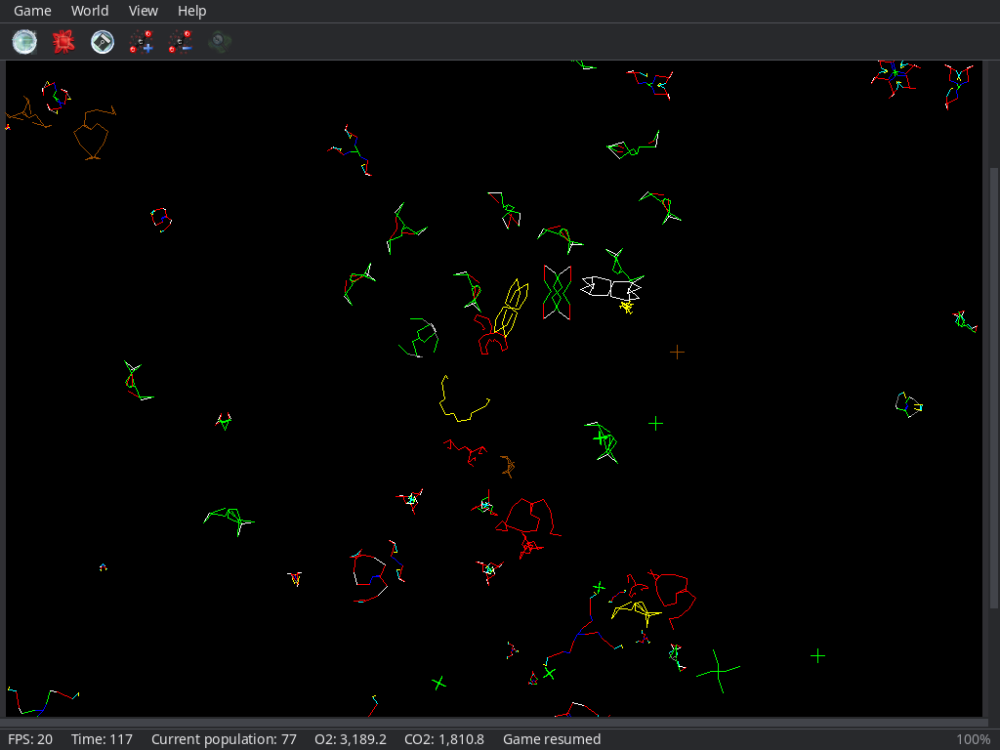

SYN-BIOGENESIS is a native reimplementation of
[Biogenesis](https://biogenesis.sourceforge.net/) 0.9, made as a tool for
SYN-OS so the simulator runs without Java. It isn't a remake or a game in
the same spirit: given the same seed and parameters, it computes the same
world as the original Java program, bit for bit, on every frame, about 2.2
times as fast.

Biogenesis is the work of **Joan Queralt Molina**, who wrote versions 0.1 to
0.8 (2006 to 2010), and **MarcoDBAA**, who released 0.9 in 2019 with
**Richard David Williams**'s STRtree collision detection. The simulation,
its rules, its parameters and its look are theirs; this project rewrites
them in another language and is not affiliated with them. See
[Credits](#credits).

| | | |
|---|---|---|
| 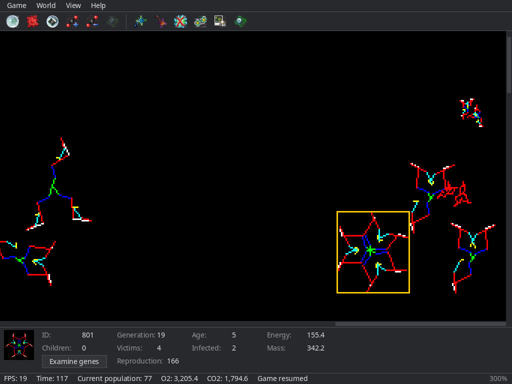 | 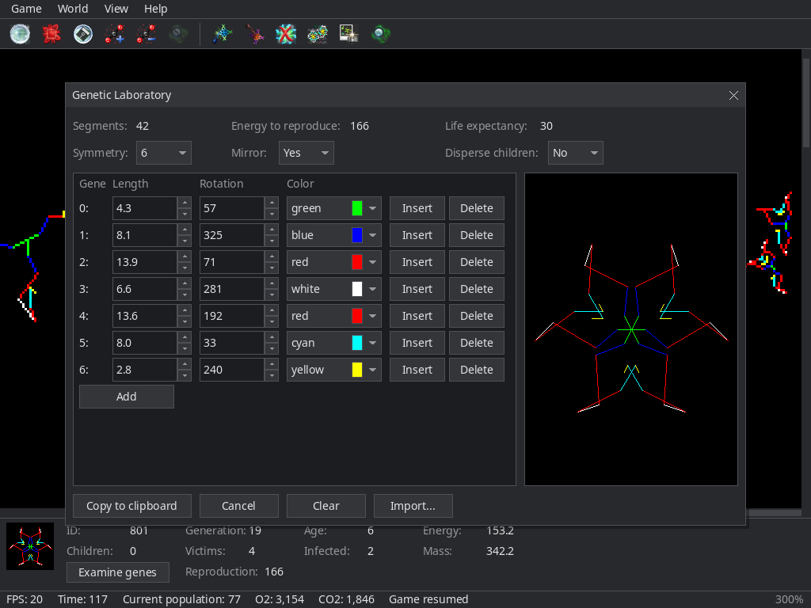 | 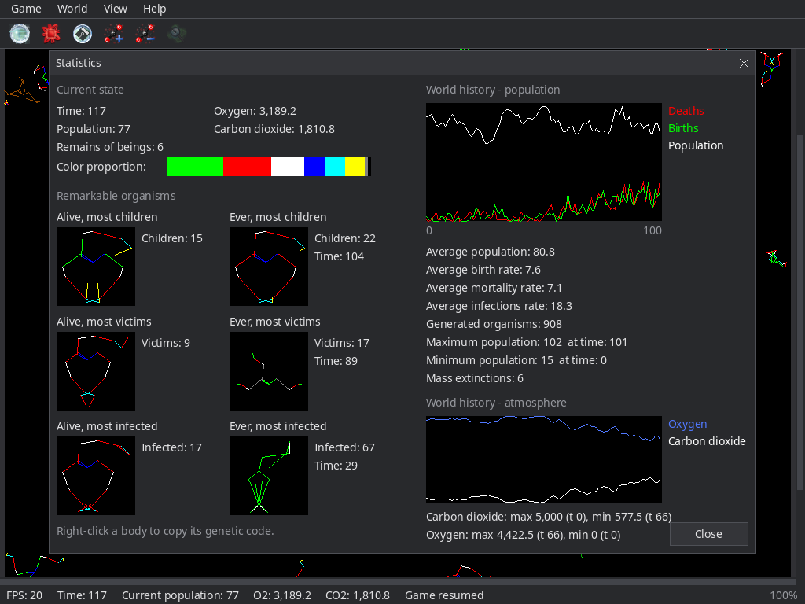 |
| An organism selected, at 300% | Genetic laboratory | Statistics |

**Contents:** [Biogenesis](#biogenesis) ·
[The reimplementation](#the-reimplementation) ·
[Lapsadian determinism and drift](#lapsadian-determinism-and-drift) ·
[Build and run](#build-and-run) · [Using it](#using-it) ·
[Color Mod 2.01](#color-mod-201) ·
[The SYN edition](#the-syn-edition) ·
[Source and tests](#source-and-tests) · [Credits](#credits)

## Biogenesis

Biogenesis is a petri dish. A world starts with fifteen random organisms in
air that holds carbon dioxide and nothing else, and from then on nobody
steers it. Organisms photosynthesise, eat, infect and kill each other,
reproduce with small copying errors, and die of age or hunger. What
survives is whatever happens to work. Leave a world running and the dish
fills with lineages nobody designed: green drifters that live on light, red
grazers that live on them, white viruses that turn other organisms into
factories for their own genetic code, blue-armoured survivors, gray
killers.

The rules are short, and nothing in them describes behaviour. An organism
is a body of coloured line segments. Each colour does one thing, and the
body's shape decides how it moves, what it touches and what it can afford.

### The colours

| Colour | What a segment of it does | Energy per use (default) |
|---|---|---|
| **Green** | Photosynthesis: energy every frame, in proportion to the segment's length and to the CO2 left in the air | 0 |
| **Red** | Eats what it touches, living or dead: up to half the segment's length in energy per frame of contact; a tenth of it is lost as CO2 | 0 |
| **Cyan** | Cilia: an 8% chance each frame of a kick along the segment, with a random spin | 0 |
| **Blue** | Shield: the segment blocks red, white and gray | 0 |
| **White** | Infection: the next child of the organism it touches is born with the infector's genetic code instead of its parent's | 1 |
| **Gray** | Kills what it touches | 1 |
| **Yellow** | More children per birth: one more per yellow segment, up to eight, sharing the same energy between them | 0 |
| **Brown** | Dead. Corpses keep drifting and decay back into CO2 | |

Parents and their children never harm each other. Organisms flash a colour
for a moment when something happens to them (bitten, infected, shielded). A
new segment is green 30% of the time, cyan 20%, and red, blue, white, gray
or yellow 10% each. Every number here is a parameter in **World >
Parameters** (PARAMETERS in SYN-OS).

Yellow is the subtle one. More segments of it don't make an organism any
richer: the energy needed to reproduce stays the same, and it is divided
between the parent and all the children. Three yellow segments give four
children, each starting with a fifth of that energy. It trades a few
well-fed offspring for many weak ones, each carrying its own mutations.

### How a world works

- **The air.** A new world holds 5,000 units of CO2 and no oxygen. The
  first fifteen organisms are each given 50 energy made from it, which
  leaves 4,250 CO2 and 750 O2. Photosynthesis turns CO2 into O2 and
  energy. Every use of energy
  (breathing, kicking, biting, infecting) is respiration and turns O2 back
  into CO2. CO2 and O2 always add up to the same total (unless you add or
  remove CO2 from the menu), so the dish is a closed carbon cycle. When
  plants boom, CO2 runs low and photosynthesis slows with it; when nothing
  photosynthesises, oxygen runs out and nothing can breathe.
- **Bodies.** A genetic code is a list of genes, each one segment: a length
  (2 to 18 pixels in a random gene), an angle and a colour. The body repeats
  that list around its centre 1 to 8 times (its symmetry), optionally
  mirroring every other copy. Random organisms start with 1 to 8 genes;
  mutation can take a code to 100. One more trait decides whether children
  scatter away from their parent or keep its speed.
- **Growing and breathing.** A newborn is drawn at about a fifth of its full
  size and grows in fifteen steps, one every 8 frames while it has energy
  to spare (a tenth of its mass); a starving organism shrinks back. Keeping
  a body costs its mass ÷ 5,000 in energy every frame, breathed with oxygen.
- **Reproduction.** A full-grown organism reproduces when its energy passes
  40 + 3 × genes × symmetry, at most once every 20 frames. Each child is
  placed beside the parent, in the first of the eight directions around it
  (starting from a random one) with room. Each trait of the copied code mutates with a 5% chance: mirroring,
  symmetry, gaining or losing a gene, and each gene's length, angle and
  colour.
- **Age and death.** An organism dies after 31 time units of 256 frames
  (7,936 frames), or as soon as it can't breathe. The "Time" in the status
  bar counts those units.

### Versions and mods

- **0.1 to 0.8**, Joan Queralt Molina, 2006 to 2010: the simulation, the
  genetic laboratory, statistics, network corridors between worlds, and (in
  0.8) the command-line seed this project's verification depends on.
- **0.9**, MarcoDBAA, 2019: STRtree collision detection by Richard David
  Williams "to make the simulation run much faster", fixes for organisms
  vanishing after collisions, German, Portuguese and Russian translations.
- **Color Mod**, MarcoDBAA, 2012 to 2022: over forty colours, methane,
  reaction genes and per-organism mutation rates.
- **X Mod 0.2.2**, Adam Muschielok, 2015: alternative mutation mechanisms and
  stress-based ageing.

SYN-BIOGENESIS reimplements vanilla 0.9, and Color Mod 2.01 beside it in
the same program ([Color Mod 2.01](#color-mod-201)). The mods
ship in the same SourceForge download as compiled classes; Color Mod's
Java source is published beside it ("ColorMod 2_01 and sourcecode.zip").
X Mod is not included.

## The reimplementation

SYN-BIOGENESIS was made for SYN-OS, to run Biogenesis there without a Java
runtime. It is the same program as a small native binary:

| | Biogenesis 0.9 (Java) | SYN-BIOGENESIS |
|---|---|---|
| Needs | a Java runtime: 98 MB (Java 8) to 159 MB (Java 21 JRE) | SDL2, SDL2_ttf, SDL2_image |
| Program | 1.3 MB jar | 190 KB binary, plus 780 KB of icons and font |
| Start to first frame, headless | 72 ms | 1 ms |
| Peak memory, 30,000 frames headless | 97 MB | 13 MB |
| Simulation speed, same world | 1× (192.4 s for 600,000 frames) | 2.2× (87.5 s) |
| When frames run late | multiplies its frame delay by 1.5; past one second, pauses the game | keeps the delay you set and catches up |
| Saved worlds | Java object serialisation (`.bgw`) | opens and saves those `.bgw` files, or its own plain binary `.sbw` |
| Without a window | no | `--headless`: benchmarks, state dumps, state hashes |

Timings are on an Intel i5-8500 with OpenJDK 27. Inside the window
everything from the original is where it was. The interface has a dark
theme, and the world view zooms (Ctrl+wheel, + and -). Statistics update
live. Previews of genetic codes scale up as well as down, the FPS counter
shows the rate actually reached, and parameters are saved when you press
OK.

### The same world, bit for bit

A reimplementation usually aims to play the same. This one is held to
computing the same: run the same seed in both programs and every
organism's energy, position, angle and speed agree to the last bit, on
every frame. Getting there meant reproducing the Java program's arithmetic,
not just its rules:

- **A statement-by-statement port** of `Organism.java`, `World.java`,
  `GeneticCode.java`, `Gene.java` and `WorldStatistics.java`, keeping the
  original's order of operations. C compiles it without fused
  multiply-adds (`-ffp-contract=off`) and with wrapping integer overflow
  (`-fwrapv`), as Java computes.
- **Java's library, reimplemented where the simulation uses it:**
  `java.util.Random`'s generator, `Math.round`, and the corner cases of
  `java.awt.Rectangle` and `Line2D` (checked against the JVM on 200,000
  random cases).
- **The JVM's maths.** `Math.atan2` is fdlibm, which the port uses
  (`src/fdlibm/`). `Math.sin`, `Math.cos` and `Math.pow` are not. On x86_64,
  HotSpot replaces them with Intel routines of its own, which round
  differently from fdlibm and from the C library in a few percent of
  cases. `src/sim/jvm_libm_x86_64.S` is those routines, generated
  instruction for instruction from OpenJDK's source by
  `tools/jvmlibm/gen_libm.py`.
- **The same collision order.** When several organisms touch in one frame,
  the first contact found wins, and 0.9 finds contacts through a JTS
  STRtree. `src/sim/world.c` builds the same tree (the same packing, the
  same stable sorts, the same traversal), so contacts are found in the
  same order.
- **The original's bugs, kept.** Fixing any of these would change how every
  world evolves, so they stay:
  - The moment of inertia adds each segment's `cy²` without multiplying
    by its mass, so bodies spin more easily than physics says.
  - In the collision response, the second organism's spin uses `rbpy * ny`
    where `rbpy * nx` was meant.
  - **Feed** (organism menu) gives 10 energy and *adds* 10 CO2, where it
    should take it. The total of CO2 and O2 grows each time you use it.
  - The test for parallel lines in collisions treats every negative
    determinant as parallel. It then places the contact at the midpoint of
    the four ends instead of where the segments cross.

Checked against the shipped jar itself: its own classes, unmodified, run
headless next to the C port and both dump their state every frame (see
[Source and tests](#source-and-tests)).

- **Identical over 30,000 frames on each of 10 seeds**, every frame
  compared.
- **Identical over 600,000 frames on each of 3 seeds**, every 100th frame
  compared.
- **Identical over 20,000 frames on each of 100 seeds**, every frame
  compared by hash (the drift study below).
- **Genetic codes** (`.bgg`) are read as 0.9 reads them: the same files
  accepted, the same values to the last bit, the same files refused. Checked
  on 1,003 files: 909 the 0.9 jar wrote (random, mutated for 200
  generations, evolved in worlds, extreme values, 100 and 500 genes), the
  15 in the [Biogenesis gallery](https://biogenesis.sourceforge.net/gallery.en.php),
  and 79 hand-made variants (other encodings and line ends, references and
  entities, DTD defaults, number forms Java accepts and refuses). Also
  checked on 300,000 random number strings against `Double.parseDouble`.
- **Saved worlds** (`.bgw`) pass both ways:
  - A world started here saves to exactly the bytes 0.9 saves: 30 of 30
    seeds and lengths, from a new world to 7,000 frames.
  - Each program loads the other's files and continues identically.
  - A loaded file saved again is unchanged, 30 of 30.
  - A world loaded and then run on saves with the same content as 0.9's
    file, but not always the same bytes. After loading, 0.9 holds two
    copies of some colours (the ones it read and its own constants) and
    writes both. 0.9 continues identically from either file.
  - Files Java 8 wrote load here, and Java 8 loads these and saves them
    back unchanged.
  - 4,000 damaged files are refused or loaded without a crash, checked
    under the address and undefined-behaviour sanitizers.
- `Math.sin`, `cos` and `pow` identical to the JVM on 12 million inputs,
  including huge, tiny, infinite and NaN ones; `atan2` on 2 million. `make
  test` repeats 2 million of each.

The reference is OpenJDK 27 on x86_64, with the same parameters on both
sides. Each program keeps its own: this one in
`~/.config/syn-biogenesis/params.cfg`, the Java one in Java's preferences.

## Lapsadian determinism and drift

Biogenesis is a lapsadian world, in the sense of Laplace's demon: know the
state of the dish at one frame and the rules, and every later frame is
fixed. Nothing in it is truly random. All of its chance (mutations, cilia
kicks, where a child lands) comes from one pseudo-random stream started by
the seed, so a seed isn't the start of a world, it is the world's entire
history. That is what makes a bit-for-bit reimplementation possible, and
checkable.

The demon's catch is that the rules include the arithmetic. Every
floating-point operation rounds to 53 bits, and `sin`, `cos` and `pow` are
computed by routines that may round the last bit differently in a few
percent of cases. The Java specification allows exactly that: `Math.sin`,
`cos` and `pow` only have to be within one unit in the last place of the
exact result, so implementations may differ; only `StrictMath` must give
the same bits everywhere. Biogenesis uses `Math`.

### How one last bit becomes a different world

What happens to a one-bit difference depends on where it lands. Run seed
42 on the C library's maths instead of the JVM's, and at frame 1,121 one
result rounds the other way. The difference appears in the last bit of
organism 13's spin. A frame later it has spread to the velocity of
organism 22, whose bounding box overlaps 13's. Five frames after that it is
gone. Each of those values receives a change tens to hundreds of times
larger than itself, and the one-bit difference falls below the precision
of the sum and rounds away. From frame 1,127 the two worlds are identical
again.

Differences heal like that when they are absorbed into larger numbers or
clamped at a speed limit. One that isn't absorbed keeps spreading, and
once it reaches a decision it can't be rounded away: an integer bounding
box that moves by a pixel, a contact that happens a frame earlier, a child
that finds room on the other side of its parent. From then on the
difference is in what happened, not in a rounding. Seed 42's two worlds
are never identical again from frame 4,501, and the number of organisms
alive differs by frame 9,480:

<picture>
  <source media="(prefers-color-scheme: dark)" srcset="docs/drift/population-dark.svg">
  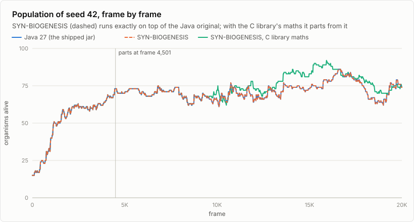
</picture>

After two worlds part, the gap between them grows the way chaos grows. In
the median seed it starts around 10⁻¹⁴ of a pixel and grows about tenfold
every 150 to 200 frames, for well over a thousand frames in which nothing
on screen differs. It crosses one pixel 1,550 frames after the worlds part
with the C library's maths, 1,708 with Java 8 and 2,787 with fdlibm.
Within a few hundred frames more, the same organism is hundreds of pixels
away in the other world:

<picture>
  <source media="(prefers-color-scheme: dark)" srcset="docs/drift/growth-dark.svg">
  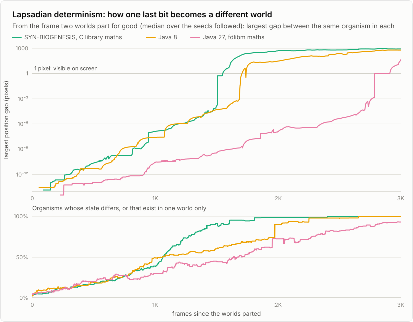
</picture>

### Seeds, Java versions and processors

The drift study (`tools/drift/`) runs 100 seeds for 20,000 frames each on
the shipped jar and on other implementations, and compares each with Java
27 on every frame:

<picture>
  <source media="(prefers-color-scheme: dark)" srcset="docs/drift/divergence-dark.svg">
  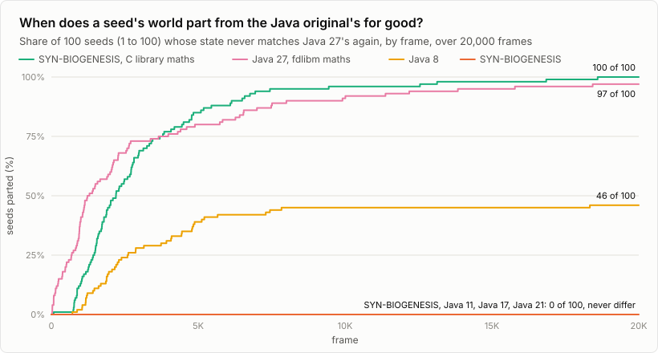
</picture>

| Compared with Java 27 | Same world for all 20,000 frames | Seeds that ever differ | First difference: median frame (range) | Seeds that part for good | Frame they part: median (range) | Differences that healed |
|---|---|---|---|---|---|---|
| SYN-BIOGENESIS | 100 of 100 | 0 | never | 0 | never | 0 |
| Java 21 | 100 of 100 | 0 | never | 0 | never | 0 |
| Java 17 | 100 of 100 | 0 | never | 0 | never | 0 |
| Java 11 | 100 of 100 | 0 | never | 0 | never | 0 |
| Java 8 | 44 of 100 | 56 | 2,477 (716 to 18,337) | 46 | 2,342 (716 to 18,337) | 16 |
| Java 27, fdlibm maths | 0 of 100 | 100 | 80 (1 to 10,250) | 97 | 1,211 (24 to 18,433) | 613 |
| SYN-BIOGENESIS, C library maths | 0 of 100 | 100 | 1,651 (80 to 7,443) | 100 | 2,199 (80 to 18,600) | 88 |

Per-seed results are in [`docs/drift/results.csv`](docs/drift/results.csv).
What each run says:

- **SYN-BIOGENESIS** never differs from Java 27 on any seed.
- **Java 11, 17 and 21** don't either. Their `sin`, `cos` and `pow` give
  exactly Java 27's results here, on a million random inputs.
- **Java 8** computes `sin` and `cos` its own way (about 2.5% of inputs
  round differently from Java 27). The Biogenesis jar was built for it. On
  44 of the 100 seeds no difference ever shows in 20,000 frames; on 46 the
  worlds part for good, at a median of frame 2,342.
- **Java 27 with `-XX:-UseLibmIntrinsic`** turns the Intel routines off and
  computes `Math` with fdlibm, which is what HotSpot does on processors it
  has no routines for. In OpenJDK 27's source, the RISC-V, POWER and s390
  ports install none of their own for these. Every seed differs, the first
  time after a median of only 80 frames, but most of those differences
  heal (613 in all) before the worlds part for good. 97 of the 100 seeds
  part, at a median of frame 1,211.
- **SYN-BIOGENESIS on the C library's maths** (`make libc`) is what a build
  for a processor other than x86_64 runs. Every seed parts for good, at a
  median of frame 2,199.

Not measured here:

- **ARM (aarch64):** HotSpot has its own `sin` and `cos`, described in its
  source as an optimised fdlibm, and computes `pow` with fdlibm.
- **AMD:** Intel's `pow` uses `rcpps`, an approximate reciprocal whose exact
  results differ between processor makers. SYN-BIOGENESIS executes the same
  instruction, so it matches the JVM on whatever x86_64 processor both run
  on.
- **32-bit x86 before Java 17:** the JVM could keep intermediate results in
  80-bit x87 registers, so even `+` and `×` could round differently (JEP
  306 made all floating point strict in Java 17).

So the Java program has never been one world per seed. It is one world per
seed, per JVM family and processor. SYN-BIOGENESIS reproduces the one that
modern HotSpot computes on x86_64. A saved world (`.bgw` or `.sbw`) holds
every organism's exact state but not the random-number stream, which
neither program saves, so a loaded world takes a new path from there.

### The dice telescope: a world's seed, read back from its save

Laplace's demon needs the state and the rules. A saved world has the
state but not the random stream. In the SYN edition,
`syn-biogenesis --telescope` gets the stream back by treating
java.util.Random as algebra rather than as a sequence. Every draw is the
same step, x → A·x + B (mod 2⁴⁸), with A = 0x5DEECE66D and B = 11. So:

- **Any number of draws ahead or back** is one affine map, built in about
  log₂ n compositions: `--telescope jump STATE N` (N negative to go back).
- **A seed counts only through its 48 low bits.** `setSeed` keeps (seed XOR
  A) mod 2⁴⁸, and every 48-bit state is the start of exactly one seed in
  [0, 2⁴⁸): `--telescope seed S`. Seeds 42 and 42 + 2⁴⁸ make the same world
  (checked on the jar), so there are at most 2⁴⁸ worlds for each set of
  parameters.
- **A gene's length gives away the state that drew it.** The length is
  2 + 16u, and u = `nextDouble()` is 53 bits of two consecutive states. A
  length read exactly leaves one state that could have drawn it, found
  among 4 million candidates in milliseconds: `--telescope gene LENGTH`.
- **The draws between two states can be counted.** The generator's period
  is all 2⁴⁸ states, so every state is some number of draws after any
  other: the discrete logarithm of the step. Modulo a power of two it is
  easy, since the low k bits of the states repeat every 2ᵏ draws, and the
  count is read a bit at a time in 48 steps. From a seed's first state to
  a gene's, it is the draw the gene was made at.

A world keeps its genes, and a founder's gene that no mutation has touched
since tick 0 is still the draw the generator made when the founders were
made. `--telescope world FILE` cracks the world's gene lengths, commonest
first, steps the generator back from each (4,096 draws), and makes the
founders from every state on the way. The seeds whose founders include the
gene are ranked by how many of their founders' genes are still in the
world, and replayed from tick 0 until one gives the saved world exactly.
The replay is the proof: a seed a founder's worth of draws earlier or later
makes a near twin, with most of the same founders.

Replays of the wrong seeds are cut short. The save's statistics keep
records with the time unit each was set in (the highest and lowest O2, CO2
and population, the most children, kills and infections), and the oldest
organism's age gives the tick it was born. A wrong seed is turned away at
the first of these it gets wrong. When the right one is found, the end of
its replay is the generator's state at the saved tick, the one thing the
file lacks.

On worlds the 0.9 jar made and saved itself, from seeds the telescope was
not told:

| Saved by the jar | Organisms | Founder genes still there | Found | Replays | Time |
|---|---|---|---|---|---|
| seed 123456789, tick 0 | 15 | 56 of 56 | seed 123456789 | 1 | 0.2 s |
| seed 123456789, tick 3,000 | 73 | 50 of 56 | seed 123456789 | 1 | 0.4 s |
| seed 1760990000123, tick 20,000 | 58 | 7 of 86 | seed 1760990000123 | 7, six turned away at tick 512 | 3.4 s |
| seed 98765, tick 60,000 | 90 | 1 of 61 | seed 98765 | 511, 510 turned away by tick 7,424 | 6.4 min |

The founders are the telescope's only way back to tick 0, and over a long
run their genes go: a gene's length is redrawn in 5% of births, so along a
line of 200 generations about one length in 30,000 comes through unchanged.
In `syn1.sbw`, a world played to tick 1,494,509, the best of the 17,269
seeds the telescope finds share three genes with it, no more than wrong
seeds do (in the 60,000-tick world above, 376 wrong seeds shared two or
more), and its earliest record is from tick 888,320, so every wrong seed
would cost that many ticks to turn away. A gene born of a later mutation
gives the generator's state at the moment it was drawn. Counted from a
seed it gives the draw it was made at, but it can't say which seed: every
seed a few draws to some millions of draws before it is one to try. How
fast a world's genes move away from its seed, and what that leaves of the
seed to read, is measured in [`docs/fade/`](docs/fade/README.md). And
anything done to a world from the menus (an import, CO2 added) takes it off
the thread its seed began, so no seed replays to it.

**On its own thread.** The generator's state at the saved tick is what a
loaded world needs to go on as the world it was, not down a new path. In
the SYN-OS interface, TELESCOPE on the main menu runs the search on this
world or a saved one. It runs in this program started again, because the
search uses the same random generator and parameters as the world on
screen. Once the seed is found, OPEN ON ITS OWN THREAD opens the save with
the generator where it was. Without a window, `syn-biogenesis --headless
--load FILE --generator STATE` does the same. Checked against the jar:

- **Without a window:** the jar's save of seed 123456789 at tick 3,000,
  run 1,000 frames from the generator the telescope found, is byte for
  byte the file the jar itself saves at tick 4,000 (in `make test`).
- **In the window:** the same save, opened on its own thread and run to
  tick 3,004, is the jar's world at tick 3,004 in every simulation field.
  The two files differ only in each organism's `_framesColor`, which counts
  a flash down as it is drawn: the window counts it down, the jar without
  a window never does, and the original's own window would.

**Where a being lives.** TELESCOPE > WHERE A BEING LIVES (WHERE IT LIVES
on a being in the library or the arena's record, Where on a selected
organism's card or menu, or `where` in the console) runs the telescope the
other way: from a being's genes to the worlds they were drawn in.
`--telescope find FILE.bgg` does it without a window, and `--telescope
crack FILE.bgg` gives the algebra alone, in a fraction of a second. The
seed-cracking engine behind it ([`docs/crack/`](docs/crack/README.md)):

- **Its genesis ancestor, from one gene.** A founder is a fixed run of
  draws, five before its genes and five per gene. So any gene the being
  still has from its founder, its length cracked to the state that drew
  it, steps back to the state the founder was begun at, and drawing again
  from there gives the whole founder: every gene, the arms, the
  mirroring. On 200 worlds' founders that came out exact for all 13,506
  genes.
- **Every seed that makes the ancestor.** Seeds a few draws apart soon
  make the same founders from the same states (the Kruskal count), so a
  founder is in about 14 seeds on average, sometimes 200. Each is found by
  trying every seed up to a few hundred draws per founder before it.
- **Its mutations, in the order they were drawn.** Each length or angle
  the being has that its ancestor hasn't is a later draw, placed by its
  count of draws from the ancestor.
- **Which seed it lives in, and where it reigns.** The seeds are run the
  likeliest first. As each run's stream passes one of the being's later
  draws, the gene drawn there has to be in a child just made, or that
  world isn't the being's and is given up at once, most within a few
  hundred ticks. The scenes now include where its ancestor's bloodline is
  left alone and where the being is alive while it is: it reigns, the
  winning state.
- **How likely its bloodline is to be the one left.** A plant's rate of
  turning light into children, from its code alone (green length, mass,
  reproduction energy, litter), weighed against the other founders'.

A winner from a seed 589 world (founder 14, eight genes, seven arms) is
found among the 62 seeds that make its ancestor in 4 seconds: its genes
drawn at ticks 438 to 10,195, alive from 10,240, reigning at time 66. The
arena's rounds, whose seeds are in the record, are searched as before. A
being whose founder genes are all gone (#496, from `syn1.sbw`) still has
its genes put in order on one stream, but which stream is lost: the fade
([`docs/fade/`](docs/fade/README.md)).

**Forge a winner.** TELESCOPE > FORGE A WINNER (`--telescope forge`) runs
the same weighing forwards. About 13,000 seeds a second are weighed from
their founders alone, without running a world. The ones whose likeliest
bloodline is likeliest are run until one bloodline is left, and the being
it is left as is the winner, to KEEP, JUMP to, or look up. Each forging
goes on through the seeds where the last stopped.

## The ultimate being

A fast, exact simulation can play the game for you. [`docs/being/`](docs/being/README.md)
is a tournament run on it to find the best genetic code to import into a
world in play.
- **Scale:** 572 codes, 9,292 imports and about 172 million frames, which
  is roughly 100 days of play.
- **The champion, #496:** a seven-armed plant armoured with blue. Imported
  once into that world at 24 spots it had never seen, its line was alive
  20,000 frames later at 21 of them.

The page also has:
- every competitor, and the tournament as a graph in the SYN-OS theme
- battles between the finalists under a battle protocol that replays
  exactly, the start of a planned tournament mode
- every code, ready for the window's **Import**

## Build and run

Needs a C compiler, SDL2, SDL2_ttf and SDL2_image (on Arch:
`sdl2-compat sdl2_ttf sdl2_image`).

```sh
make
./syn-biogenesis            # what was used last; the first time, Biogenesis 0.9
./syn-biogenesis 42         # Biogenesis 0.9, seeded, like `java -jar biogenesis.jar 42`
./syn-biogenesis --colour   # Color Mod 2.01
```

`make` builds one program, `syn-biogenesis`, with everything in it:
**Biogenesis 0.9** and **[Color Mod 2.01](#color-mod-201)**. Each runs in
its own classic window (the Heritage edition) or in the
[SYN-OS interface](#the-syn-edition), with its themes, main menu, options,
statistics, zoom at the cursor, drag to pan and new looks.

The first run is Biogenesis 0.9 as the original looks. Each window can
switch to the other simulation:

- View > Color Mod 2.01 in Biogenesis' window, View > Biogenesis 0.9 in
  Color Mod's;
- the commands (`/`), or SIMULATION in OPTIONS, in SYN-OS.

Switching asks whether to save the world first, as quitting does. The
program opens with the simulation used last
(`~/.config/syn-biogenesis/variant.cfg`). View > SYN-OS interface, and
INTERFACE in OPTIONS, change the interface; both simulations share the
choice, the theme and the look.

Without a window, for benchmarks and long runs:

```sh
./syn-biogenesis --headless --seed 42 --frames 100000 --report 10000
./syn-biogenesis --colour --headless --seed 42 --frames 1000
```

`./syn-biogenesis --help` lists the forms. The parameters are kept in
`~/.config/syn-biogenesis/params.cfg` (Color Mod's in `colour-params.cfg`).

The two simulations are two programs inside this one. Their organisms,
worlds and windows are written with the same names, so Color Mod's whole
program is linked as one object with every name hidden except its entry
point (see the Makefile and `src/launcher.c`). Biogenesis 0.9's
simulation is the translation compiled with nothing else. Through this
program it matches the jar frame by frame (`make test`).

### Windows

The same program builds on Windows 10 and 11 with
[MSYS2](https://www.msys2.org). In its UCRT64 shell:

```sh
pacman -S --needed make mingw-w64-ucrt-x86_64-gcc mingw-w64-ucrt-x86_64-pkgconf \
    mingw-w64-ucrt-x86_64-SDL2 mingw-w64-ucrt-x86_64-SDL2_ttf mingw-w64-ucrt-x86_64-SDL2_image
make
make dist
```

`make` builds `syn-biogenesis.exe`, linked statically: SDL and the
libraries it uses are inside it, so it needs no DLL but Windows's own and
runs from Explorer or any shell, with the `assets` folder beside it.
`make dist` puts it, without its debugging information, in
`dist/syn-biogenesis/` with the assets; that folder runs on any 64-bit
Windows 10 or 11 without MSYS2. Every push builds and
checks it on GitHub Actions (`.github/workflows/build.yml`, beside the
Linux build), and each run keeps the folder as a download,
`syn-biogenesis-windows-x86_64`.

It is a window program. Run from Command Prompt or PowerShell, `--help`
and `--headless` write to that console, which does not wait for it; piped
(`| Out-Host`, `| more`), it waits. Settings are kept in
`%APPDATA%\syn-biogenesis`.

It runs the JVM's `sin`, `cos` and `pow` there too, the same routines
entered through a frame for Windows's calling convention
(`tools/jvmlibm/`), so it matches the jar frame by frame on Windows as
well. `make test` runs in the UCRT64 shell, with a JDK on the `PATH` for
the JVM checks and `tools/javaref/fetch.sh` run for the comparisons with
the jars.

## Using it

Everything from the original is in the same place: **Game** (new, pause,
open, save, quit), **World** (statistics, genetic laboratory, CO2 up/down,
kill all, disperse all, parameters), and the right-click menus on organisms
(track, feed, weaken, force reproduction, rejuvenate, kill, copy, export,
save image), on corpses (revive, disperse) and on empty space (paste,
create randomly, import).

| Input | Does |
| --- | --- |
| Left click | select an organism (info bar at the bottom) |
| Right click | organism / corpse / empty-space menu |
| P or Space | pause / resume |
| S, Ctrl+S | save (Ctrl+Shift+S: save as) |
| Ctrl+O, Ctrl+Q | open, quit |
| Wheel, Shift+wheel, arrows, middle drag | scroll |
| Ctrl+wheel, + / - / 0 | zoom in, out, actual size |
| Esc | deselect |

### Differences from the Java version

- **World files:** Open reads 0.9's `.bgw` and this program's `.sbw`;
  Save writes `.bgw` unless you name the file `.sbw`. Worlds pass both ways
  between the two programs. Neither format stores the random-number state
  or the parameters, so a loaded world continues differently in each
  program unless both are given the same seed after loading.
- **Genetic codes** stay `.bgg` and pass both ways. The only difference: a
  code with no DTD block, which 0.9 refuses, opens here as if it had 0.9's.
  Codes from 0.4 to 0.6 (genes as x and y, like the six "for version 0.6"
  in the gallery) are refused, as 0.9 refuses them. So are Color Mod codes
  that use its own colours. A Color Mod code that uses only the seven
  original colours opens in both, without its extra traits.
- **Not ported:** the Network menu (biological corridors between computers),
  translations (English only), "check last version", and the Java2D OpenGL
  options.
- **Speed control:** see the table above. The Java window's FPS display
  shows its current frame delay (1000 ÷ delay), not a measured rate. This
  one measures.
- **Making a big world:** the time it takes grows faster than the square
  of the number of organisms, because each is placed clear of every one
  placed before it. In 0.9 here, 20,000 take about 3 seconds and 50,000
  about 35; on the same curve, 150,000 would take about 12 minutes. A world that takes more than a quarter of a
  second is shown being made, with how far it has got. Esc starts it with
  the organisms made so far, and closing the window quits. The parameters
  dialog says, under the initial number, how long that many will take when
  it is more than ten seconds. Made to the end, the world is the one the
  original makes. This holds in both simulations and both interfaces.

## Color Mod 2.01

`./syn-biogenesis --colour`, or a switch from Biogenesis 0.9's window, runs
**Biogenesis Color Mod 2.01**
by MarcoDBAA, the mod with 46 gene colours, methane, genes that branch,
36 kinds of reaction per gene, per-organism mutation rates and life
expectancy, in C. Like Biogenesis 0.9 here, it computes the world the shipped
Color Mod computes, bit for bit: same seed, same parameters, same world on
every frame.

Color Mod is a much bigger program than 0.9. Its `Organism.java` alone has
19,336 lines, most of them the rules for what each colour does when it
touches another. Those classes (`Organism`, `GeneticCode`, `Gene`) are not
ported by hand: `tools/colour/translate.py` translates Color Mod's own Java
source into `src/colour/sim/`, keeping Java's meaning where C's differs
(the order operands are evaluated in, `(int)` of a double, `Math.round`,
`Math.min` with NaN and -0.0, strings shared by reference). The world, its
statistics and the parameters follow the 0.9 port with Color Mod's
changes. The checks, against the shipped Color Mod jar (`make test`, with
`tools/javaref/fetch.sh` run):

- **The simulation:** seeds 1, 42 and 1234 in Color Mod's default world
  (7000 x 7000, 12,500 organisms at the start) give the same state as the
  jar, compared every tenth frame for 3,000 frames: every organism's energy,
  position, angle, speeds, size, age and kills, and the atmosphere. Those
  runs execute 76% of the translated organism code's lines.
- **Worlds (.bgw):** a world saved here is the file Color Mod saves, byte
  for byte; each program opens the other's and continues it identically.
- **Genetic codes (.bgg):** read and written as Color Mod's own parser does,
  for codes written by either program, mutated, evolved in a world, with
  extreme values, and damaged.

It runs about 1.1 times as fast as the jar: 1,000 frames of the default
world in 33 seconds here, against 37 on OpenJDK 27. (The 0.9 port is
faster than 0.9 by more, partly because it caches what the translation
recomputes.)

Everything Color Mod adds to the window is there: the **Actions** menu
(CO2 and CH4 up or down by 1,000, kill all, disperse all), **Backup** (B)
and automatic backups, methane in the status bar and the statistics, life
expectancy, mutation rate and clade in the info bar, the laboratory with
the code's 22 traits and every gene's branch and reactions, and the
parameters dialog's seven tabs. Its parameters are kept apart from 0.9's,
in `~/.config/syn-biogenesis/colour-params.cfg`, with Color Mod's
defaults (its README asks for those).

It has the [SYN-OS interface](#the-syn-edition) too, as Biogenesis 0.9
has it, with its own commands (Backup, CH4 up and down), methane among the
bar's figures and the charts, its clades as the statistics' lines, its
seven tabs of parameters on the PARAMETERS screen, and the looks drawn for
its 46 colours and branching bodies.

| | | |
|---|---|---|
| 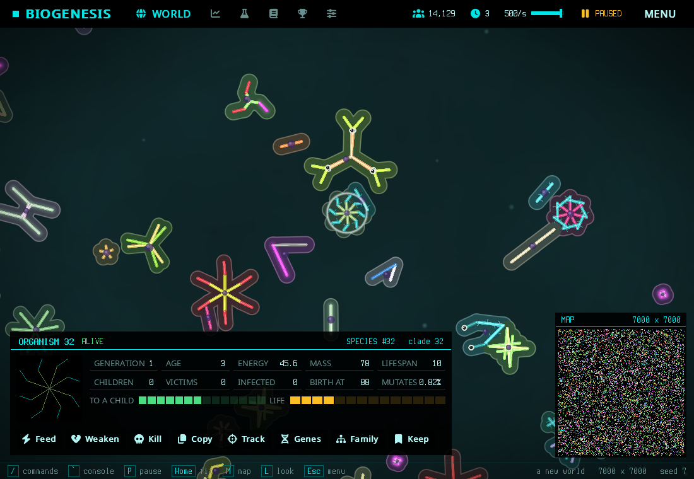 | 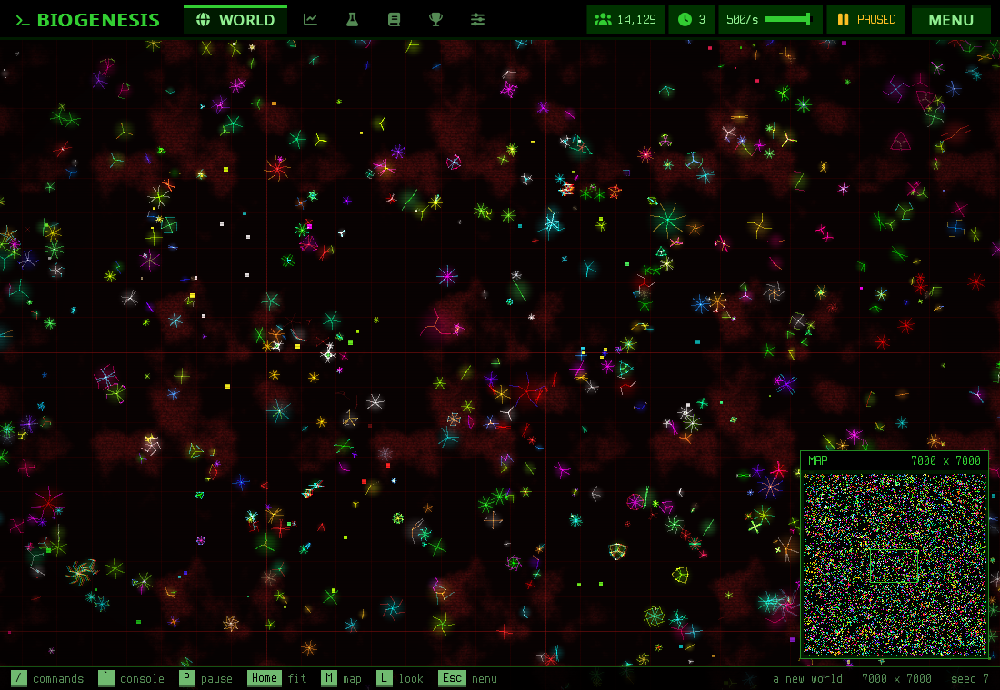 | 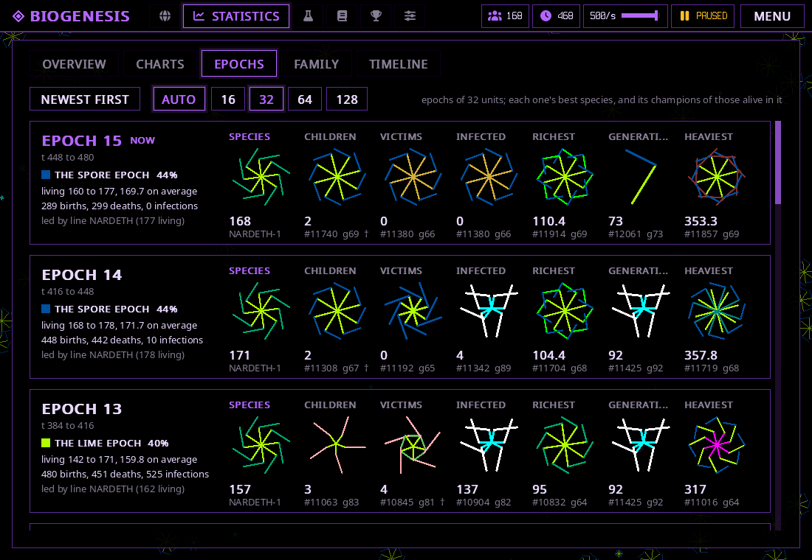 |
| Color Mod in SYN-OS, Biological, an organism's card (SYN-OS-FLATLINE-CYAN) | Digital, segments out of action dotted | Its statistics: the epochs (SYN-OS-HALO-VIOLET) |

Differences from the Java Color Mod are those of 0.9 here (no network,
English only, no version check), plus: the window opens at 1100 x 760
rather than 640 x 480, which is too small for its dialogs; and a 0.9 world
is refused with a message where Color Mod would read it with all its own
fields missing.

## The SYN edition

Both simulations have a second interface, SYN-OS: the one SYN-TREK and
SYN-DEBT share, with a new world view. It runs the same simulation as the
Heritage edition, so a seed gives the same world bit for bit; only how the
world is shown and handled differs.

| | | |
|---|---|---|
| 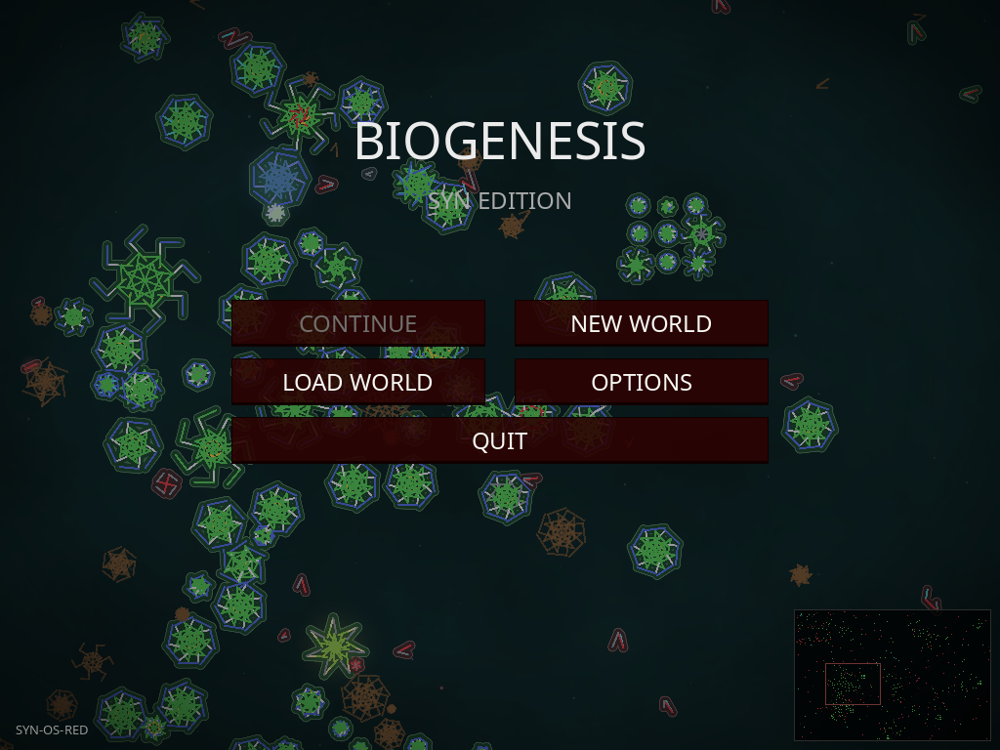 | 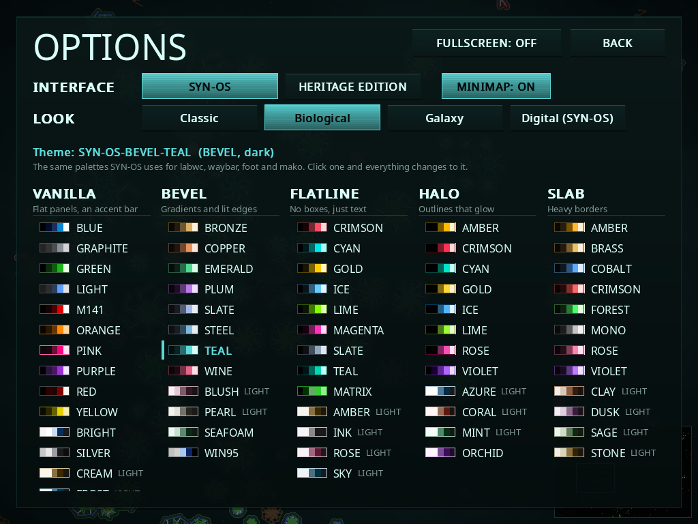 | 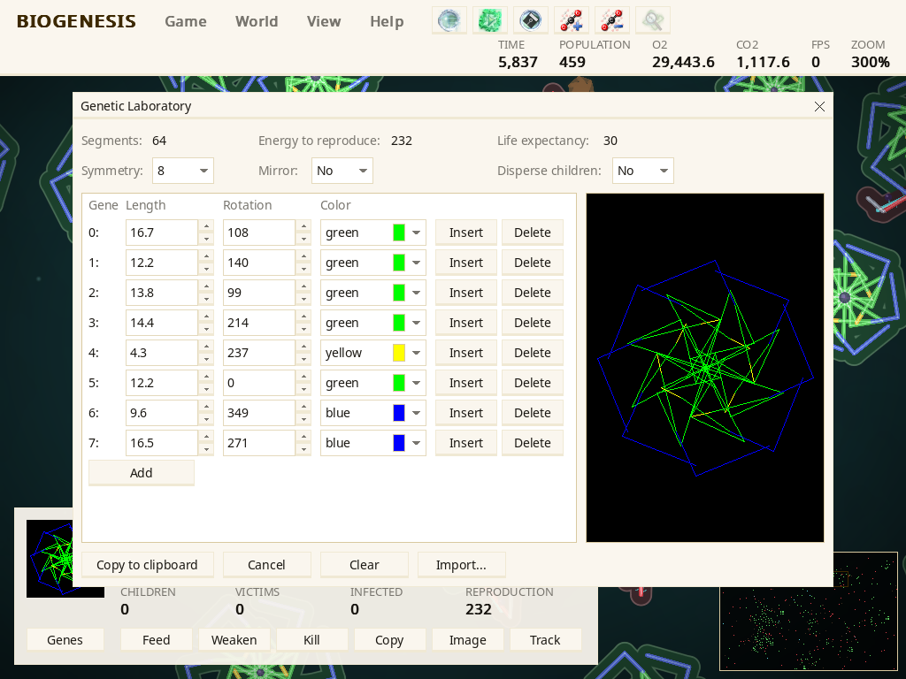 |
| The main menu over the world | OPTIONS (theme SYN-OS-BEVEL-TEAL) | The laboratory in SYN-OS-VANILLA-LIGHT-CREAM |
| 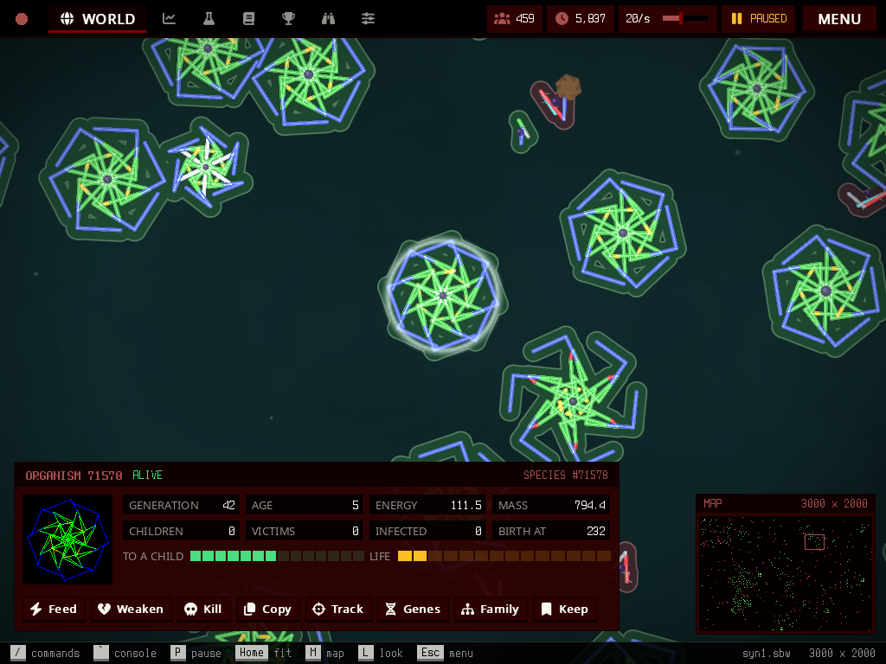 | 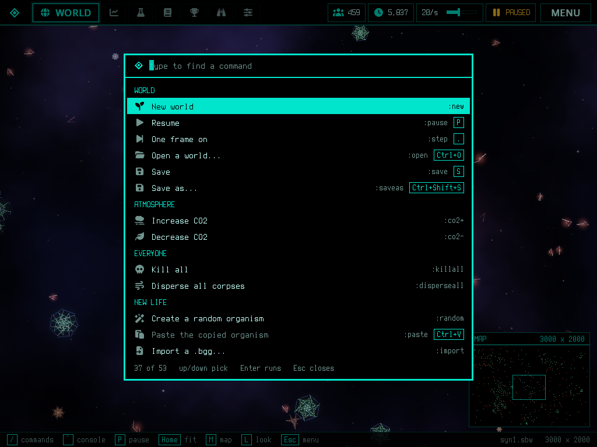 | 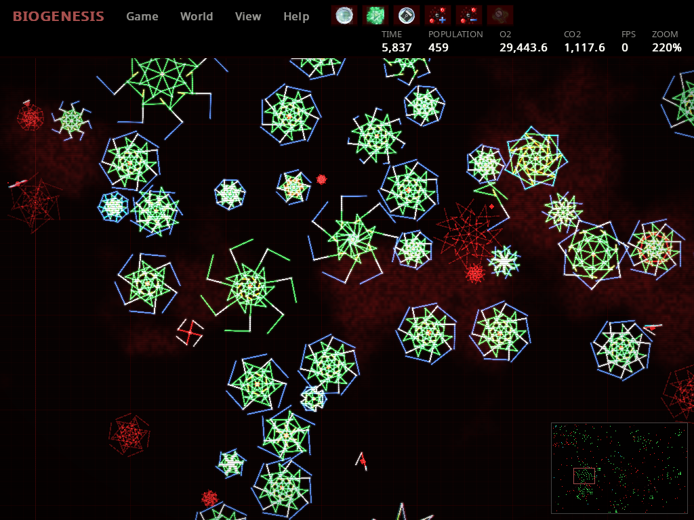 |
| Biological, an organism's card (SYN-OS-RED) | Galaxy, the commands (SYN-OS-HALO-CYAN) | Digital, the console (SYN-OS-MATRIX) |

### SYN-OS or the Heritage edition

**INTERFACE** in OPTIONS (or View > SYN-OS interface in the classic
windows) switches between two interfaces while the world runs:

- **Heritage edition**, what the first run shows, is each simulation's
  own window: menu bar, toolbar, info bar, status bar, scrollbars, the
  classic colours, and the original's mouse and keys. With the same world
  loaded, its screen is pixel for pixel that of the window built without
  any of the SYN edition, for both simulations (checked for the world, a
  selection, statistics, the laboratory and the parameters).
- **SYN-OS** opens on a main menu over the living world: CONTINUE, NEW
  WORLD, LOAD WORLD, ARENA, LIBRARY, TELESCOPE, OPTIONS, QUIT. In the
  world, the world fills the window and has no menu bar, toolbar or
  dialog boxes: everything is a screen under one bar, or a command (see
  [The shell](#the-shell-the-bar-the-commands-and-the-console)). Esc lets
  go of the selection, or with nothing selected opens the main menu.
  Every bar, panel, button, tab, field and menu is drawn in a SYN-OS
  theme.

The themes are SYN-OS's 63 palettes (`assets/themes/`, the files SYN-OS
uses for labwc, waybar, foot and mako), in its five families: VANILLA,
BEVEL, FLATLINE, HALO and SLAB. The palette gives the colours. The family
gives the shape of things, as its templates do in SYN-OS: flat panels,
gradients and lit edges, bare text, glowing outlines, heavy borders.
Until one is picked, the theme is the one SYN-OS has on
(`~/.config/syn-os/current-theme`), else SYN-OS-RED. Choices are kept in
`~/.config/syn-biogenesis/synos.cfg`. `SYN_BIOGENESIS_INTERFACE=heritage`
(or `synos`) and `SYN_BIOGENESIS_THEME=SYN-OS-HALO-CYAN` set them for one
run.

### The shell: the bar, the commands and the console

In SYN-OS, the world and its screens sit under a shell made of SYN-OS's
own desktop, as its waybar, mako, wmenu, foot, labwc and TUIs draw it
(`src/syn/shell.c`). What the machine writes (the console, the menus,
the notifications, the hints, the figures) is in SYN Terminal, which is
Terminus as SYN-OS uses it everywhere. The icons are Font Awesome's, as
waybar's are.

- **The bar**, waybar's. The theme's glyph and BIOGENESIS open the command
  list. Then come the screens as tabs: WORLD, STATISTICS, LABORATORY,
  LIBRARY, ARENA, TELESCOPE (0.9's) and PARAMETERS. The world's figures sit
  in modules at the right: running or PAUSED (a click toggles it), the
  speed (scrolled or dragged), time, population, O2, CO2 (and CH4 in
  Color Mod), frames a second and zoom (a click fits the world). Then
  MENU. As in waybar, a module turns to the warning colour (paused;
  frames a second well short of the speed asked for) or blinks critical
  (nothing alive). When the window narrows, the tabs keep only their
  icons but the one shown, then figures go from the left.
- **The commands** (`/`, or the glyph): wmenu's and fuzzel's list of
  everything the menus and toolbar did, and more, under headings like
  SYN-OS's root menu: WORLD, ATMOSPHERE, EVERYONE, NEW LIFE, THE ORGANISM
  SELECTED, VIEW, SCREENS, SYSTEM. Typing filters it; up and down pick,
  Enter runs, Esc closes. Each command shows its key and its name in the
  console.
- **The console** (`` ` ``): a drop-down foot with syn-shell's command line.
  Every command runs by its name (`pause`, `co2+`, `killall`, `keep`), and
  it has its own: `info`, `params`, `get` and `set NAME VALUE` (checked as
  the parameters dialog checks them), `speed N|max`, `run N` frames as fast
  as they go, `co2 + N`, `find ID` (selects an organism and flies to it),
  `goto X Y [ZOOM]`, `zoom`, `look`, `theme`, and the random generator's:
  `seed` (the seed a world made here came from), `generator [STATE]`,
  `jump N`, and in 0.9 the dice telescope's algebra (`telescope seed S`,
  `telescope jump STATE N`, `telescope gene LENGTH [ANGLE]`). Tab
  completes, up and down go through what was typed, Ctrl+L clears, and
  `help` lists it all. What the window says goes in it too.
- **Notifications**, mako's: at the top right, in the panel colour inside
  a 3px accent border, for five seconds.
- **The right-click menu**, labwc's: titled with what was clicked
  (ORGANISM 6, CORPSE 12, THE WORLD AT 280, 459), with icons and keys.
- **The organism card**, SYN-TREK's target card: the selected organism in
  a labwc title bar with its state and species, its body, its figures in
  wells, two segmented bars (its energy towards a child, how much of its
  life has gone), and its actions.
- **The hints**, the status line of SYN-OS's TUIs: keys along the bottom,
  and the world's file, size and seed at the right.

The screens: **PARAMETERS** is each simulation's own parameters, a card
each with what it does, its default (a click puts it back), whether it
waits for the next world, and a stripe when it isn't the default; the
colours of the genes are a table with each colour's share of a random
gene. A value is taken as it is entered and saved, parsed and checked as
the original's dialog does on OK; one it refuses stays red. The
**LABORATORY** fills the screen under the bar. Files are opened and saved
in syn-crypter's three columns (the folder above, this one with sizes and
dates, and a preview that draws a `.bgg`'s being), with the path as
buttons, HOME and `/`, and keys. Questions (save before quitting, replace
a file) are SYN-DEBT's dialogs.

| | | |
|---|---|---|
| 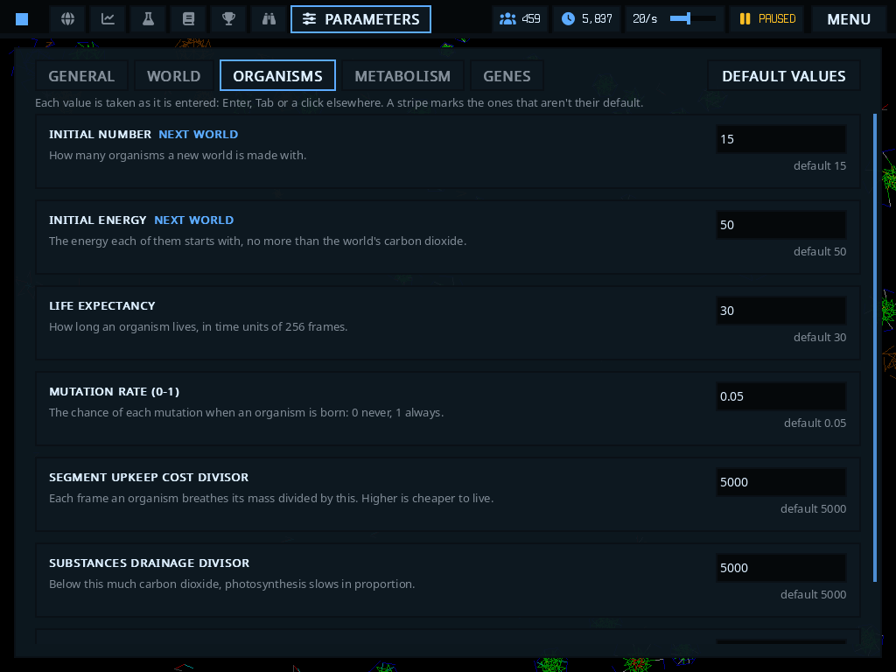 | 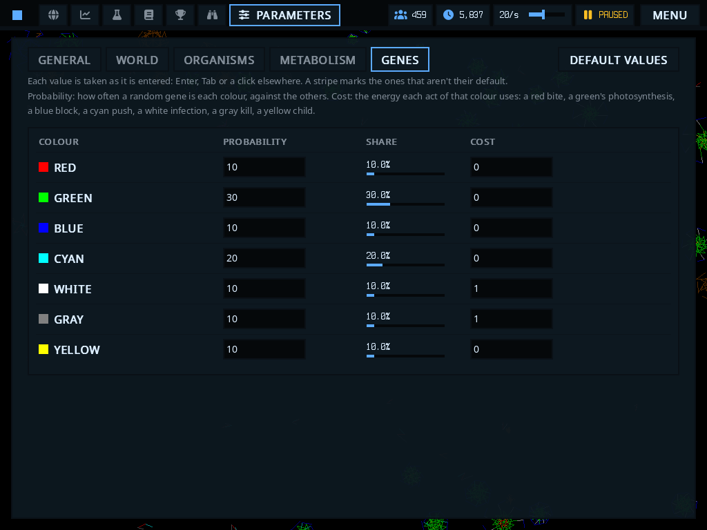 | 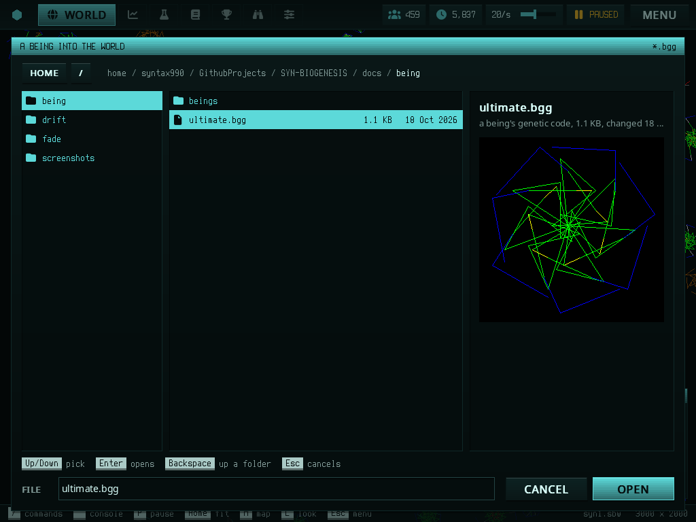 |
| PARAMETERS (SYN-OS-SLAB-COBALT) | The genes: each colour's share of a random gene | A being into the world: its body in the preview (SYN-OS-BEVEL-TEAL) |

### Moving around

In SYN-OS (the Heritage edition keeps the original's scrollbars and keys):

| Input | Does |
| --- | --- |
| Wheel | zoom at the cursor, eased (touchpads zoom smoothly) |
| Left or middle drag | pan; let go while moving and the view glides on |
| Left click | select (a press that doesn't drag) |
| Shift+wheel, arrows | scroll |
| + / - / 0 | zoom in, out, 100% |
| Home | fit the world |
| M | minimap on or off |
| L | next look |
| P or Space | pause, go on |
| . | one frame on, while paused |
| / | the commands |
| `` ` `` | the console |
| F11 | fullscreen |
| T, F, G, Del | the selected organism: track, feed, its genes, kill |
| Ctrl+C, Ctrl+V | copy the selected organism, paste it at the cursor |
| Esc | let go of the selection; the main menu |

Zoom runs from 3% to 4,800%. The minimap sits at the bottom right while
part of the world is out of view; click or drag in it to move there.
Dragging lets go of a tracked organism.

### Statistics

In SYN-OS, **STATISTICS** in the bar opens a statistics screen over the
running world (the Heritage edition keeps the original's window). It has
five tabs, switched with 1 to 5. The wheel, Page Up and Down, Home, End
and the bar at the right scroll it (the family tree moves and zooms
instead).

| | | |
|---|---|---|
| 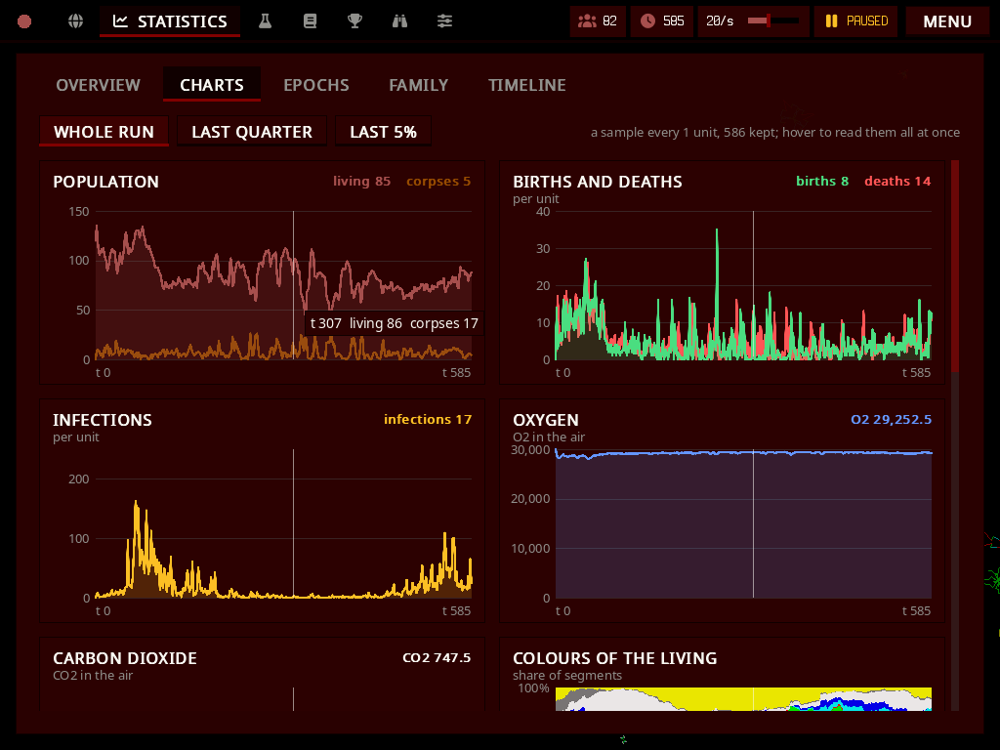 | 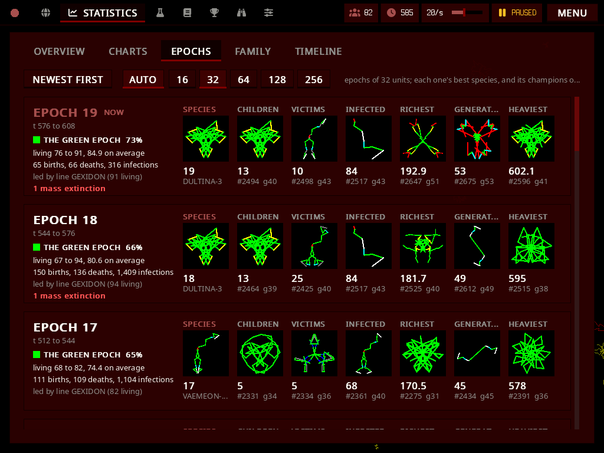 | 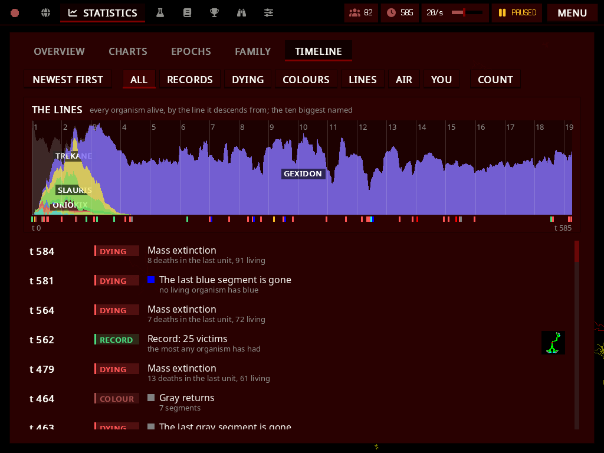 |
| Charts, hovered together | Epochs, their best species and champions | The lines' river, and what happened |
| 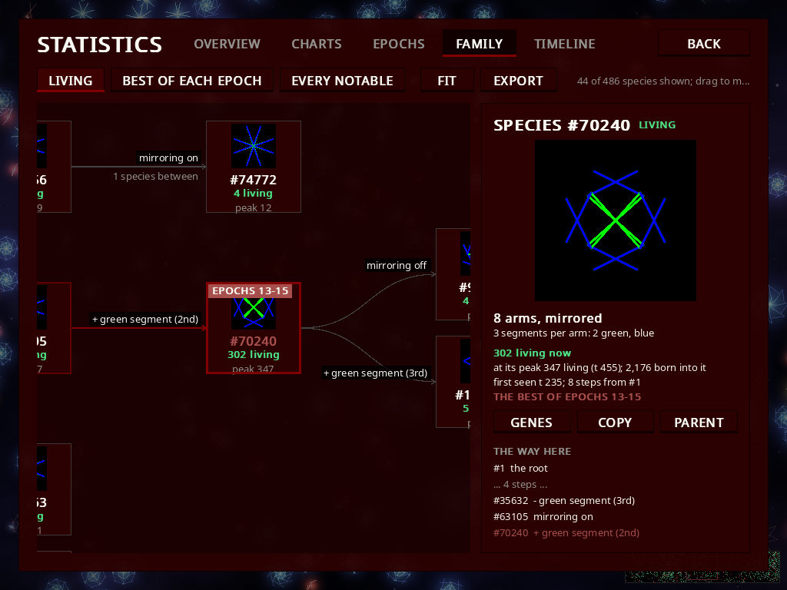 | 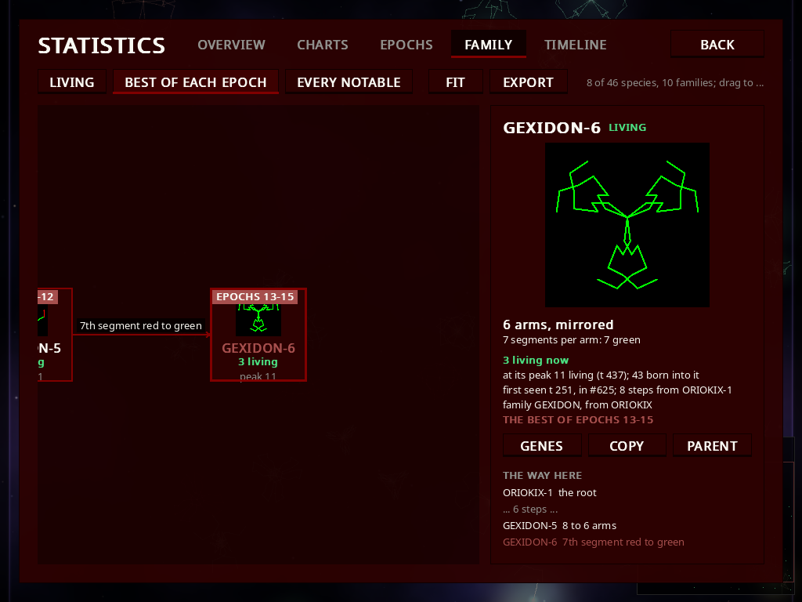 | 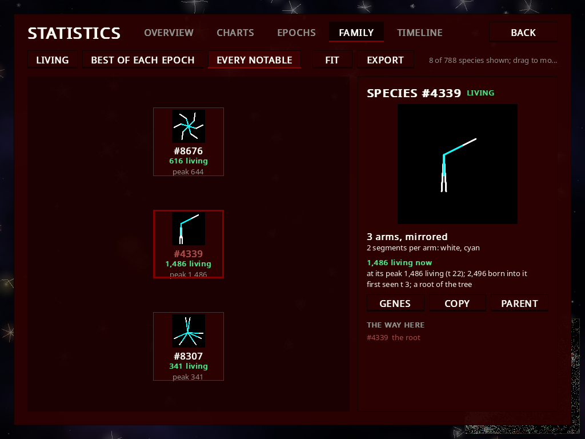 |
| The family tree: the species living now, DULTINA-3 followed | The best of each epoch, from SLAURIS-1 and TREKANE-1 on | Color Mod's, from its clades |

- **OVERVIEW:** the world now: time, living, corpses, lines living, the
  gases, the original's averages, mass extinctions and the most ever
  alive. Also the colours of the living, the champions alive now, and the
  records the original's window keeps (the most children, victims and
  infections ever; the last born, dead and infected).
- **CHARTS:** twelve measures over the whole run: population and corpses,
  births and deaths per unit, infections, oxygen, carbon dioxide, the
  colours of the living, mean and highest generation, lines living, mean
  energy, biomass, body size and age. Show the whole run, its last
  quarter or its last 5%. Hovering one chart reads the same moment on all
  of them.
- **EPOCHS:** the run cut into epochs, newest first. Each epoch shows its
  span and its colour ("THE GREEN EPOCH"). It also shows the living
  (lowest, highest, mean), the births, deaths and infections, the line
  that led it, and its mass extinctions. Then comes its best species, the
  one with the most living at once in it (a click follows it in the
  family tree), and its champions: of the organisms alive in it, the most
  children, victims and infections over their lives, the most energy, the
  highest generation and the heaviest. The length of an epoch is chosen
  to give about 24 of them, or by hand. (They were called ages, which an
  organism has too.)
- **FAMILY:** the [family tree](#the-family-tree), drawn live as Graphviz
  draws a graph.
- **TIMELINE:** first the river of the lines: every living organism by
  the line it descends from, with the ten biggest named. It shows counts
  or shares of the living, with the epochs marked along the top and the
  events under it. Below it are the events, filtered by kind:
  - population and organism records, at the times the world records them;
  - mass extinctions;
  - colours dying out, coming back or taking the lead;
  - lines taking the lead or dying out;
  - CO2 or O2 running out;
  - what you did (CO2 added or taken, organisms killed, placed, revived
    and so on).

A click on any organism shown opens it in the genetic laboratory, and a
right click copies its code. Esc or BACK returns to the world.

The history starts when the world is created. Saving a world also writes
a file beside it, its name and `.syn` (`world.bgw.syn`), with the history
and the [family tree](#the-family-tree) and its names; opening the world
reads it, and both go on as if the world had never been closed. The world
file itself is the one the original saves. The sidecar records the world
file's size and a hash of its bytes; if the world has since been saved by
another program or replaced, or there is no sidecar, the history starts
when the world is opened. It is recorded once a time unit (256 frames) for the
whole run. Samples merge in pairs past 4,096 and epochs past 1,024, so a
long run is kept at a coarser grain. A line is every organism descended
from one founder: in Biogenesis 0.9, the roots of the family tree. Its
founders are each organism of genesis, each body plan in a world when it
is opened, and each organism created at random or imported by hand (a
pasted copy joins the species of the organism it was copied from). Color
Mod keeps lines itself: a clade ID begins with its founder's number, so
the lines are the clades' roots, and they go on in saved worlds. Apart
from 0.9's lineage mark (below), the recorder only reads the world.
`make test` runs the same world with and without it, for both
simulations, and checks that every frame's state, the random generator
and the saved `.bgw` are identical (Color Mod's with its collector running
every frame while it records). It also checks that the recorder's books
balance: every birth, death and infection falls in exactly one epoch; and
the family tree's: every parent founded before its children, every living
organism in a species and their counts the population's, each epoch's
best kept, nothing kept that should have been forgotten, every family
begun by an ancestor and every name given once. Every 64 time units it
saves the tree and loads it back, which must change nothing: the world
runs on identically and the tree saves the same bytes again. A damaged
saved tree must be refused.
Color Mod adds methane to the figures and the charts.

### The family tree

The statistics screen's FAMILY tab shows where the world's species came
from, live as the world runs, drawn left to right the way Graphviz draws
a graph. Each box is a species with its founder's body, how many are
living (or when it died out) and its peak. Each edge says what changed
on the way: "6 to 7 arms", "mirroring on", "+ blue segment (8th)",
"3rd segment green to red".

- **A species** is a body plan in Biogenesis 0.9: the number of arms,
  the mirroring and the colours of the segments in order. Lengths and
  angles mutate within a species; a birth that changes the plan founds a
  new species, a child of the one its code came from. That is its
  parent's, or for an infected parent's child, the infecting organism's.
  The species rides on the genetic code's lineage mark, which the
  simulation copies from parent to mutated child (and from the infecting
  code) and never reads. In Color Mod a species is one of its own clades,
  whose ID is already a family path (its founder, then a step wherever the
  gene count or the symmetry changed), so its tree is read, not recorded,
  and survives saved worlds.
- **Names:** species are grouped into families. A root of the tree begins
  one, and so does a species whose plan has moved far enough from the plan
  its family began with: in 0.9, four changes, counting each arm gained or
  lost, mirroring turned on or off, and each segment added, removed or
  recoloured as one; in Color Mod, three steps of its clade (each a change
  of gene count or symmetry). A family is given the next of 500 names when
  the first of its species has 5 living at once (and one in 50 of the
  living): invented ones (VELORAX, ZEPHYRA, SILORN, KESTORA ...) with the
  Greek letters among them, in a fixed mixed order, then the same again as
  VELORAX II. Each species is numbered in its family when it gets there:
  VELORAX-3. Until then a species is written as biologists write one not
  yet named, VELORAX sp., or by its founder's number (#1234) while its
  family has no name. Names are given once a time unit from the world
  alone, so they are the same whatever was on screen. A box where a family
  begins is marked NEW FAMILY, the card says which family a species is in
  and which family that one came from, and the organism panel shows the
  selected organism's species. A line is called by the name of the family
  its root began (the VELORAX line).
- **What is shown:** LIVING (the 40 biggest species alive now), BEST OF
  EACH EPOCH (each epoch's best, marked with its epoch), or EVERY NOTABLE
  (the 150 biggest that ever had 5 living at once and one in 50 of the
  living), each with all it descends from. Species in between that are
  only ancestors fold into the edge ("4 species between").
- **Moving:** drag to move, the wheel zooms at the cursor, FIT (or Home)
  shows it all. A click follows a species: its path to its root lights
  up, and its card at the right gives its plan, its numbers and the way
  there step by step (click a step to follow it). A double click opens it
  in the genetic laboratory and a right click copies it. Backspace
  follows the parent.
- **EXPORT** writes the tree as shown into a folder beside the world
  (`WORLD-family-tTIME`; for a world never saved, in the folder the game
  started in): `family.dot`, rendered to `family.svg` and
  `family.png` if Graphviz is installed, a picture and a `.bgg` of every
  species shown (`VELORAX-3.png`, `VELORAX-3.bgg`; one not numbered as
  `species-FOUNDER-ID`), and the best of each epoch compiled as
  `epoch-NN-NAME.bgg` with an index, `best-of-each-epoch.txt`.

Species that never mattered are forgotten once they die out (most are
one-off mutants): those that never had 5 living at once and one in 50 of
the living, with nothing kept descending from them and best of no epoch.
So the tree stays small however long the world runs. The world's sidecar
(see [Statistics](#statistics)) carries the tree with its names and
numbers; without one, the tree begins when the world is opened.

### The being library

LIBRARY, on the SYN-OS main menu and in the arena, keeps genetic codes from
one launch to the next, in folders. It is a real folder tree, one for each
simulation, since 0.9's and Color Mod's `.bgg` files can't be read by each
other:
`~/.config/syn-biogenesis/beings/0.9/` and `.../beings/colour/` (on
Windows, in `%APPDATA%`). Each being is a `.bgg`, the original's own
format, with an `.about` file beside it saying where it came from and when.
The folders are the categories, nested as deep as wanted; a `.bgg` dropped
into one from outside the program is in the library too.

- **In:** Keep on a selected organism (its card and its right-click menu),
  Keep in the laboratory, "Keep in the library" on any being in the arena,
  the statistics and the family tree, and IMPORT .BGG for files from
  anywhere. A first library has Saved, Imported, Arena and Bin.
- **The arena's ladder** is a folder of its own, read only and live: the
  arena's beings for its settings as they are now, best first, any of
  which can be kept in the library.
- **Out:** TO THE ARENA puts a being on the ladder at level 1, to fight
  beings of its level (`--arena --enter FILE.bgg` does it without a
  window). INTO THE WORLD places it at the world's middle or the nearest
  room; GENES opens it in the laboratory; COPY puts it on the clipboard.
- **Kept in order:** beings are renamed in place, moved between folders,
  and deleted to the Bin; deleting there, or EMPTY BIN (two clicks),
  removes them for good. Folders are made, renamed, and removed when
  empty. Names keep to what every file system takes.

### The arena's record

The arena (ARENA on the SYN-OS menu, or `--arena` without a window) runs
worlds on every core as a ladder that winners climb. Its ladder keeps who
stands where; its record keeps every round for good, in
`~/.config/syn-biogenesis/arena-0.9.record` (`arena-colour.record`). For
each round it keeps:
- the seed, level, settings and outcome
- the time one bloodline was left alive
- the winning bloodline's **genesis being**, the code it began the round as
- its **final being**, the one the round ended with
- the fighters, with their codes
- the living and the bloodlines through the round

ARENA > RECORD shows what it adds up to: when one bloodline was left, the
bloodlines through each round drawn over each other, and how many genes
the final being has changed from the genesis being. It lists every round
with its two beings, each with WHERE IT LIVES.

Rounds from before the record are rebuilt from the ladder with
`syn-biogenesis --arena --rebuild-record`. Each being on the ladder has the
seed of the round it won, so its round is replayed from that seed, in each
order of its fighters and with and without newcomers. It is kept as
replayed only if the replay ends with the very being the ladder kept, byte
for byte; otherwise as the ladder alone has it. `--arena --record` prints
the record.

### Looks

Chosen in OPTIONS, the commands (`/`) or with L, and remembered in
`~/.config/syn-biogenesis/syn.cfg` (`SYN_BIOGENESIS_LOOK=galaxy` picks
one for a single run). Every look keeps what the colours mean, in its
own palette.

- **Classic:** Biogenesis' own pixels, as the Heritage edition draws them.
- **Biological:** a drop of water under a microscope. Each organism is a
  cell, its segments strands in cytoplasm inside one membrane. The
  nucleus swells with stored energy, cilia beat along the segments that
  move it, corpses lie as sepia strands, and the water drifts with motes
  in it.
- **Galaxy:** each organism a galaxy, its segments glowing arms around a
  core that brightens with energy, over nebulae and three layers of stars
  that lie behind the world in parallax. Zoomed out, the organisms are
  stars.
- **Digital (SYN-OS):** viruses on a SYN-OS screen, in its black, reds
  and gold: neon wireframes with nodes on a grid, the wallpaper's
  grime, scanlines, a hit splitting an organism's red and cyan, newborns
  boxed in as they spawn, corpses broken into flickering dashes.

For Color Mod's 46 colours, each look keeps what each colour does. The
seven colours Color Mod shares with 0.9 are drawn as 0.9's look draws
them. The others keep their hue in the look's light and saturation, so
they stay apart. A colour's job shows:

- cilia on cyan and teal;
- eyes look out, as an eye, a winking star or a target reticle;
- healers glow (coral, mint, lavender, magenta, rose, indigo), with a plus
  in Digital;
- segments out of action for now (frozen, broken, withered, recharging,
  poisoned) are greyed, dark lanes in Galaxy, dotted in Digital.

Bodies are built as Color Mod builds them, with branches and longer eyes.

The three new looks draw each organism at screen resolution, as
antialiased strokes, from the genes' exact lengths and the organism's
exact position and angle (the simulation rounds the body to whole pixels
on every frame). When the simulation runs slower than the screen (a frame
delay of 8 ms or more; the default is 50), organisms move smoothly
between frames instead of jumping, growth is eased, and newborns swell
out from a point. None of this feeds back into the simulation.

## Source and tests

```
src/sim/        simulation: organism, world (with the STRtree), genetic code, stats,
                java.util.Random, java.awt geometry semantics, parameters, and the
                JVM's sin/cos/pow (jvm_libm_x86_64.S, generated)
src/fdlibm/     fdlibm's atan2, which is what Math.atan2 is
src/io/         .bgg genetic codes (XML); .bgw worlds (Java serialization, jser.c);
                .sbw worlds
src/ui/         SDL2 front end: immediate-mode widgets, world view, dialogs
src/colour/     Color Mod 2.01: sim/ (organism and genetic_code translated from
                Color Mod's Java, params generated, world and stats ported, jrt the
                Java runtime they need), io/ (.bgg, .bgw), ui/ (its window and dialogs)
src/syn/        the SYN edition's world view: navigation, the looks, batched drawing;
                its history (history.c), family tree (family.c, family_view.c)
                and statistics screen (stats_screen.c);
                palette.c, the segment colours of both simulations;
                the arena (arena*.c), its rounds' worlds (round.c) and record
                (record.c); the dice telescope (telescope.c), its
                seed-cracking engine (crack.c) and its screen
                (telescope_screen.c); the being library (library.c) and
                its screen (library_screen.c); the shell over the world and its
                screens: bar, commands, console, notifications, menus, card,
                dialogs (shell.c); the parameters screen (params_screen.c)
src/synos/      the SYN-OS interface: themes (as SYN-DEBT reads them), the skin
                (SYN-DEBT's, drawn with SDL_Renderer, with waybar's modules,
                labwc's title bars and mako's notifications), the main menu and
                options
src/headless.c, src/main.c   Biogenesis 0.9 without a window, its arguments
src/launcher.c, src/host.h   the program: runs Biogenesis 0.9 or Color Mod, switches
src/compat.h, src/win/       Windows: the POSIX calls it lacks, the icon and manifest
tests/          make test
tools/javaref/  the Java reference: runs the shipped jar headless (colour/: Color Mod's)
tools/colour/   the Java-to-C translator for Color Mod (translate.py)
tools/jvmlibm/  translates HotSpot's sin/cos/pow into jvm_libm_x86_64.S
tools/drift/    the drift study and its charts (docs/drift/)
tools/being/    the being search, the battles and their charts (docs/being/)
tools/win/      makes the Windows icon from the original's
tools/fonts/    makes SYN Terminal (Terminus, cut down) and copies Font Awesome
```

```sh
tools/javaref/fetch.sh   # once: downloads Biogenesis 0.9 and Color Mod 2.01, builds both references
make test
python3 tools/colour/translate.py   # regenerates src/colour's translated files
```

`make test` runs these checks:
- the file formats: a world saved and reloaded mid-run, as `.sbw` and as
  `.bgw`, continues identically, and damaged files are refused
- 800 damaged `.bgw` files loaded without a crash
- the genetic-code cases in `tests/bgg_cases/` (what 0.9 reads from each
  is in its `expected.txt`)
- the geometry, maths and number-parsing checks against the JVM
- genetic codes written by the jar (and the gallery's, once fetched), read
  by both programs
- worlds saved by the jar and by the port, compared byte for byte, loaded
  by the other and continued
- the frame-by-frame comparison with the shipped jar
- the dice telescope: jumps land where single draws do, seeds start where
  `setSeed` starts them, every gene length and angle the simulation draws
  cracks back to its state, the count of draws between two states is the
  jump that joins them (and a gene drawn 12,345 draws in is found there),
  and the seed of a world the jar saved at tick
  3,000 is found from the save and replayed identical; that save, run
  1,000 frames on from the generator found, is the jar's own tick 4,000;
  the engine draws every founder of 12 worlds again from its genes, finds
  each world among the seeds that make its founders, and places a length
  drawn 54,321 draws after a founder at that count
- the being library, in a folder of its own: codes kept exactly, moved,
  renamed, binned and imported byte for byte, folders made and removed,
  and names that would leave the library kept inside it; and a being from
  a `.bgg` put on the arena's ladder at level 1
- the SYN edition's history, for both simulations: the same world run with
  and without it hashes the same every frame and saves the same `.bgw`,
  and its books add up; the recorded run's world is made an organism at a
  time, as the window makes it, and the plain one's all at once; and the
  history and tree, saved as a world's sidecar holds them, reset as an
  opening resets them and loaded back, save the same bytes, while cut or
  altered ones are refused
- for Color Mod (`tests/colour.sh`): the same checks against the
  Color Mod jar for genetic codes, worlds and the simulation

The Java parts are skipped without a JDK. The reference runs the jar's own classes, not
recompiled and not patched. Only the Swing classes they call into are
replaced with no-op stand-ins, so they run without a window.

`tools/fade/fade.py` reruns the fade study (about 25 minutes on six cores; see
[`docs/fade/README.md`](docs/fade/README.md#running-it-again)).

`tools/drift/drift.py` reruns the drift study (about half an hour on six cores;
see [`tools/drift/README.md`](tools/drift/README.md)).

For UI checks without a display, the app has a test hook driven by
environment variables (see `shot_prepare` and `Script` in `src/ui/app.c`):

```sh
SDL_VIDEODRIVER=offscreen SYN_BIOGENESIS_SHOT=out.png SYN_BIOGENESIS_SHOT_SIM=3000 ./syn-biogenesis 42
SDL_VIDEODRIVER=offscreen SYN_BIOGENESIS_SCRIPT="wait 5; click 300 300 r; click 340 344; shot a.png; quit" ./syn-biogenesis
SDL_VIDEODRIVER=offscreen SYN_BIOGENESIS_SHOT=out.png SYN_BIOGENESIS_SHOT_LOAD=world.bgw SYN_BIOGENESIS_SHOT_VIEW=1500,1000,1.5 ./syn-biogenesis
```

`SHOT_LOAD` opens a saved world (`.sbw` or `.bgw`) and `SHOT_VIEW` centres
the view on x,y at a zoom. In the SYN edition, `SYN_BIOGENESIS_SHOT_SCREEN`
is `menu`, `options` or `world` (the default when `SHOT_UI` is set), or
`stats` with `SYN_BIOGENESIS_SHOT_TAB` naming the tab (`overview`,
`charts`, `epochs`, `family`, `timeline`). On the family tab,
`SYN_BIOGENESIS_SHOT_FAMILY` is `living`, `best` or `notable`,
`SYN_BIOGENESIS_SHOT_FOCUS` follows the species with the most living, and
`SYN_BIOGENESIS_SHOT_EXPORT` exports the tree as EXPORT does. It can also
be `library`, with `SYN_BIOGENESIS_SHOT_LIBRARY` naming the folder (or
`ladder`), or `telescope`, with `SYN_BIOGENESIS_SHOT_TELESCOPE` naming a
saved world to search first (`SYN_BIOGENESIS_SHOT_TELESCOPE_DEFAULTS` for
the default parameters). Set `XDG_CONFIG_HOME` to keep such runs away
from your own library and settings.
`SYN_BIOGENESIS_GENESIS_SHOT=out.png` shows the "Creating world" screen at
once and saves it, and `SYN_BIOGENESIS_GENESIS_STOP=N` presses Esc on its
Nth frame.

## Credits

SYN-BIOGENESIS is a reimplementation. The ideas, the simulation and its
behaviour are the original's:

- **Biogenesis**, copyright (c) 2006-2010 Joan Queralt Molina:
  <https://biogenesis.sourceforge.net/>
- **Biogenesis 0.9** by MarcoDBAA (2019), with STRtree collision detection
  (JTS, by Vivid Solutions) implemented by Richard David Williams.
- **Biogenesis Color Mod**, copyright (c) 2012-2022 MarcoDBAA, GPL version 2
  or later; Color Mod here is translated from its 2.01 source, and its
  backup icon is Color Mod's.
- **Icons** are copied unchanged from Biogenesis, which credits its artwork
  to Ananda Daydream and Florian Haag
  ([Toolbar Icons](https://sourceforge.net/projects/toolbaricons/),
  copyright (c) 2010 Florian Haag, MIT licence). See
  [`assets/icons/LICENSE`](assets/icons/LICENSE).
- **JTS** STRtree, translated in `src/sim/world.c`: copyright (c) 2016
  Vivid Solutions, Eclipse Distribution License 1.0
  ([`src/sim/LICENSE.JTS`](src/sim/LICENSE.JTS)).
- **Math.sin, Math.cos, Math.pow** (`src/sim/jvm_libm_x86_64.S`): the Intel
  Math Library routines in OpenJDK's HotSpot, copyright (c) 2016, 2025
  Intel Corporation, (c) 2021 Tencent, (c) 2022, 2025 Oracle, GPL version 2
  only.
- **fdlibm** (`src/fdlibm/`) is Sun Microsystems' freely distributable libm.
- **Noto Sans** is under the SIL Open Font License (`assets/fonts/OFL.txt`).
- **SYN Terminal** is Terminus (copyright (c) 2010 Dimitar Toshkov Zhekov),
  as Terminus (TTF) (copyright (c) 2011-2021 Tilman Blumenbach) and Nerd
  Fonts' Terminess build it, cut down and renamed: SIL Open Font License
  (`assets/fonts/OFL-SYNTerminal.txt`).
- **Font Awesome Free** 7 (Fonticons, Inc.), its solid icons font
  unchanged: SIL Open Font License (`assets/fonts/LICENSE-FontAwesome.txt`).

## Licence

GPL version 2 or later, like Biogenesis (`LICENSE`), except
`src/sim/jvm_libm_x86_64.S`, which comes from OpenJDK under the GPL version
2 only; the program built with it is therefore distributed under version
2. Each source file names the original file it was translated from or
based on; the changes from the original are described above, and the
history is in git.
