# The being search

What is the best genetic code to drop into a running world? Not the best
organism in a vacuum: one copy, imported the way the window's right-click
**Import** does it, small and alone, into a world that has been evolving
for a long time, under the parameters you actually play with.

`tools/being/` answers that by simulation. It is a tournament run on the
simulation itself, the same bit-for-bit 0.9 simulation as the game, with
no window. In `syn1.sbw`, one core runs about 550 frames a second, 28
times the game's default speed of 20 (a 50 ms delay). Six cores run about
170 times faster than playing.

## The result

<p align="center">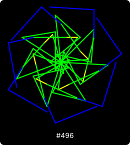</p>

**#496** is the champion for `syn1.sbw`, a world taken from play: about
450 to 500 organisms, crowded, hunters among them. Download it as
[`ultimate.bgg`](ultimate.bgg).
- **Code:** symmetry 7, eight genes (five green, two blue, one yellow),
  no mirroring, no dispersal.
- **Body:** a plant armoured with blue.

**Final round:** one import at each of 24 spots the search had never used,
each run for 20,000 frames.
- #496's line was alive at the end at 21 of the 24 spots, with 56.4 living
  descendants per import on average.
- **Its parent:** #496 was bred from the world's third commonest species
  (#417), which survived at 8 of the 24. The two differ by one mutation:
  symmetry 6 became 7, and the eight genes are the same.
- **For comparison:** the best natural champion of the long evolutions
  (#125) and the best design both died out at every spot.

<picture>
  <source media="(prefers-color-scheme: dark)" srcset="finalists-dark.svg">
  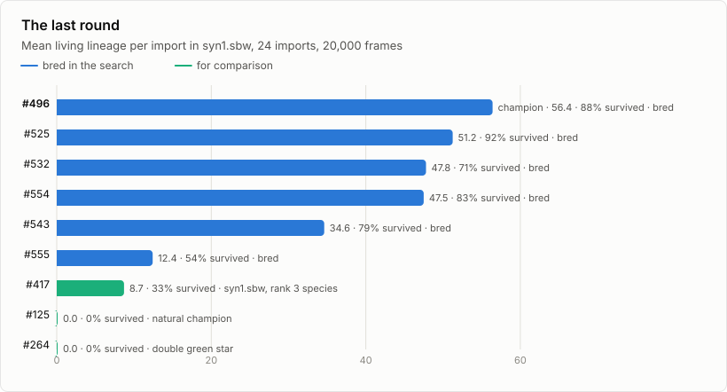
</picture>

<picture>
  <source media="(prefers-color-scheme: dark)" srcset="growth-dark.svg">
  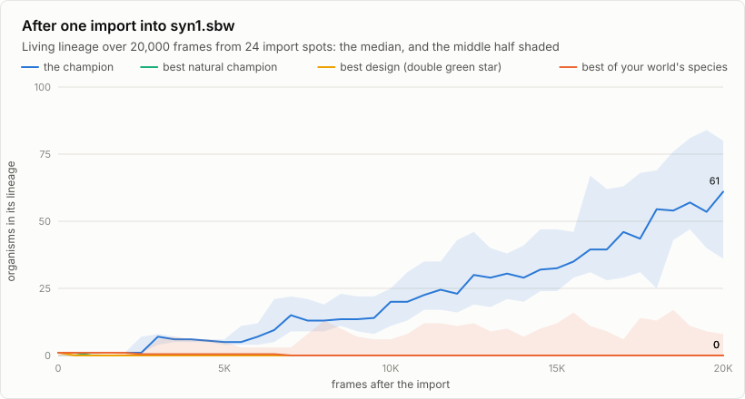
</picture>

In the game, at the end of its most typical surviving run (import spot
215, 63 descendants at frame 20,000), 39 of the 52 living organisms within
250 pixels of the centre are its descendants. They are the green plants
ringed with blue, and so is the species it came from. Brown ones are dead. An organism hit in the last few frames flashes
in a single colour, as in the game.

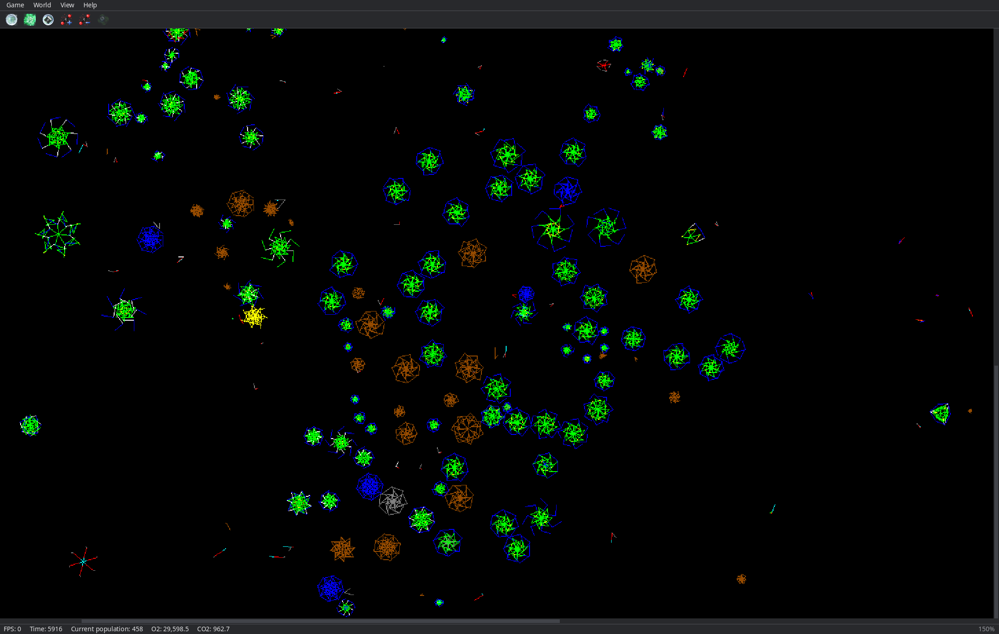

### Import it more than once

One copy can land beside a hunter. The table shows how often at least one
line was still alive 20,000 frames after importing several copies at once,
in battle mode (12 battle seeds, `being battle WORLD SEED 20000 20000
496.bgg 496.bgg ...`):

| Copies of #496 | A line alive at frame 20,000 | Its descendants then, mean |
|---|---|---|
| 1 (the last round, 24 import spots) | 21 of 24 | 56.4 |
| 2 | 12 of 12 | 66.8 |
| 3 | 12 of 12 | 116.5 |
| 5 | 12 of 12 | 139.9 |

Two copies were enough for a line to survive in every battle tried.

### A different world, a different champion

**Young worlds:** worlds freshly evolved on the same parameters, run for
30,000 to 250,000 frames. There, the best import is a plain eight-armed
green star.
- #382 kept its line alive at 75% of 60 imports into ten worlds the search
  never saw, with 32.6 descendants on average.
- #403, the best on the training worlds, did the same at 97% of 32 imports.

**`syn1.sbw`:** the same stars (#382, #403, #406, #407) died out at every
one of 12 imports each, all within 5,050 frames.

The search's first version ended at that and had nothing to tell apart in
`syn1.sbw`. That is why phase 2 now scores survival as well as lineage,
and adds the world's own species to the candidates. #496 came out of
that.

**Size of the search:**
- **Candidates:** 572 genetic codes.
- **Imports:** 9,292, after which 154 million frames were simulated.
- **Long evolutions:** another 18 million frames, run to find natural
  champions.
- **In game time:** about 100 days of play at 20 frames a second.

## How a being is scored

One copy is imported at a random free spot. It starts the way an import
does: a fifth of its full size, with 50 energy taken from the air (or
whatever CO2 is left). The world then runs on. Its score is its
**lineage** when the run ends: every living organism whose genetic code
descends from the imported one, through its own children and through the
children of organisms it infected (a white segment makes another
organism's next child carry the infector's code, and that child counts).
Every candidate in a round is scored on the same worlds and import spots,
so they are compared on equal terms.

## The tournament

1. **Candidates.**
   - The three commonest codes in six worlds evolved for 3,000,000 frames
     each, harvested every 250,000 frames: natural champions, evolution's
     own answer.
   - The three commonest in each of 16 training worlds.
   - Twelve designs built from the rules (plants, armoured plants, virus
     plants, killers, breeders, swimmers).
   - Twenty random codes.
2. **Screening:** every candidate imported into 8 training worlds,
   15,000 frames.
3. **The best sixteen** imported into all 16 training worlds, twice each,
   30,000 frames.
4. **Breeding, phase 1:** five generations. Each generation, 24 children of
   the best ten (chosen by three-way tournaments): mutations (a gene's
   colour, length or angle, a gene added, removed or copied, symmetry,
   mirroring, dispersal) and crossovers (one parent's first genes, the
   other's last), each scored as in 3.
5. **Held out:** the best six imported into 10 worlds the search never
   saw, six times each, 50,000 frames.
6. **Breeding, phase 2, in your world:** eight more generations, bred and
   scored inside a copy of the world you play (`syn1.sbw`), 12 imports of
   12,000 frames each. Your world's ten commonest species and three
   armoured designs join the candidates here. Then the best six are tried
   on 24 import spots not used before, 20,000 frames each. The best of
   those is the champion.

   An old, crowded world kills most single imports. Lineage alone can't
   tell those failures apart, so phase 2 ranks by a **score**: a run's
   lineage at the end plus 1 if its line survived, or, if it died out, the
   fraction of the run it lasted. Any survival beats any extinction, and
   lasting longer beats dying fast.

The training and held-out worlds are new worlds on your saved parameters
(`~/.config/syn-biogenesis/params.cfg`), run for 30,000 to 250,000 frames
before anything is imported.

## The search in charts

<picture>
  <source media="(prefers-color-scheme: dark)" srcset="progress-dark.svg">
  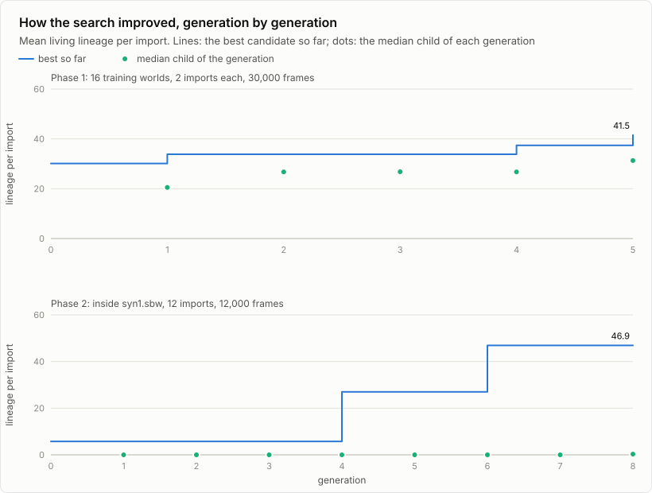
</picture>

<picture>
  <source media="(prefers-color-scheme: dark)" srcset="contenders-train-dark.svg">
  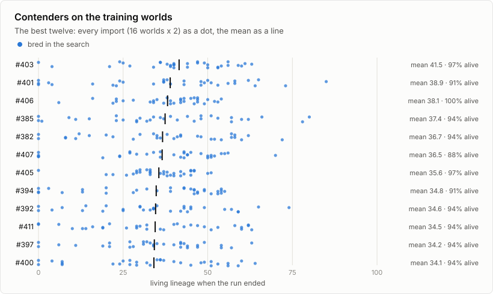
</picture>

<picture>
  <source media="(prefers-color-scheme: dark)" srcset="contenders-final-dark.svg">
  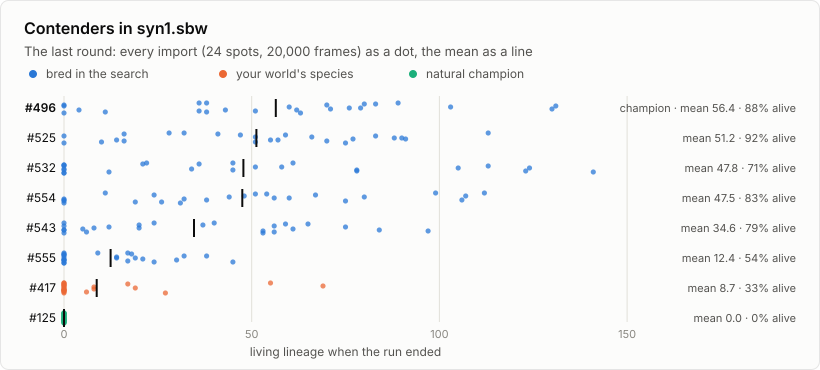
</picture>

**Every competitor:**
- [`competitors.svg`](competitors.svg) draws every one of the 572 codes the
  way the genetic laboratory does, grouped by how far it got.
- The graph below is the whole tournament in the SYN-OS theme: where the
  candidates came from, who passed screening, every bred ancestor of a
  finalist, and the champion's line of descent in the accent colour.
  [`tournament.dot`](tournament.dot) is its source.

[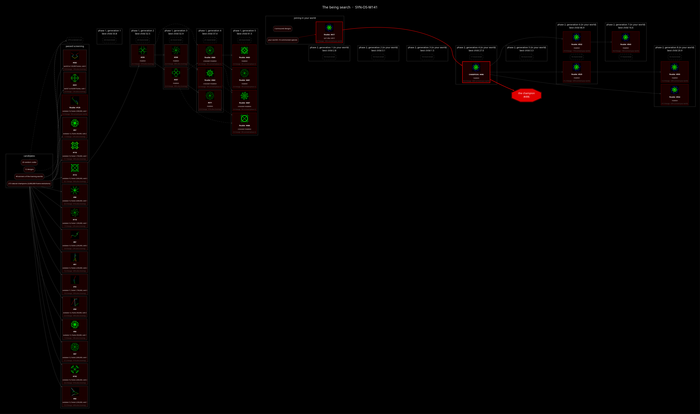](tournament.png)

## Battles

The tournament scores each being alone against an evolved world. Battles
put the last round's contenders into the same world at once and let them
fight it out, with a protocol that makes every battle replay exactly:

1. Load the world. Seed the simulation's random generator with the
   **battle seed**.
2. Seed a separate placement generator with *battle seed* × 7919 + 17.
3. Import the contenders in order, each the way the window's Import does,
   at a spot drawn from the placement generator (x, then y, uniform over
   the world; drawn again until the paste is accepted). Contender *k*'s
   genetic code carries lineage mark *k*, which its descendants inherit.
4. Run the world. Every so many frames, count each contender's living
   lineage. The winner has the largest lineage at the end.

Import order matters (earlier organisms move first every frame, and the
first import gets the first spot), so a head-to-head pairing is played in
both orders for each battle seed. `tools/being/being.c` (`being battle
WORLD SEED FRAMES EVERY A.bgg B.bgg ...`) is the reference implementation,
and [`battles.json`](battles.json) holds every game, enough to replay any
of them.

### Results

The contenders are the eight best of the last round, in `syn1.sbw`.

**Head to head:** #543 is the strongest.
- It won 35 of its 42 games and drew one.
- It beat the champion #496 in all six of their games.
- #543 is the same plant with dispersal on: each child is born moving
  away from its parent, where otherwise it would take the parent's
  velocity.

**Free-for-all:** all eight imported at once and run 100,000 frames. #496
is the most durable.
- Its line was alive at the end of five of the six battles, which no other
  contender managed.
- It finished on top in one, as did #525 and #543; #554 finished on top in
  two.
- In one battle (seed 4), all eight lines died out.

**Which to import:**
- **#496** if you import alone.
- **#543** if it will meet the other contenders.

<picture>
  <source media="(prefers-color-scheme: dark)" srcset="battles-matrix-dark.svg">
  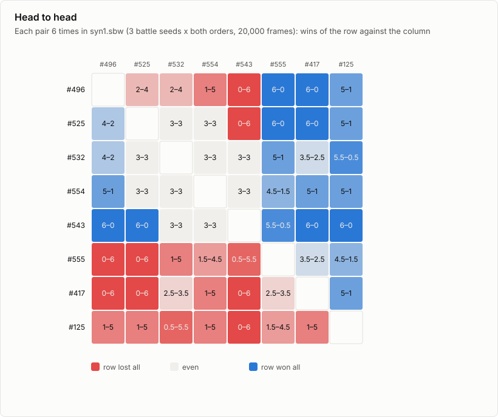
</picture>

<picture>
  <source media="(prefers-color-scheme: dark)" srcset="battles-standings-dark.svg">
  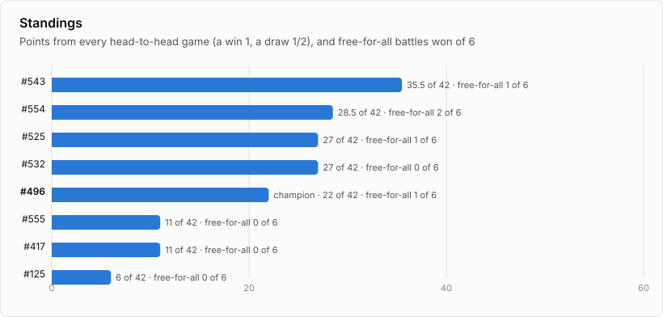
</picture>

<picture>
  <source media="(prefers-color-scheme: dark)" srcset="battles-ffa-dark.svg">
  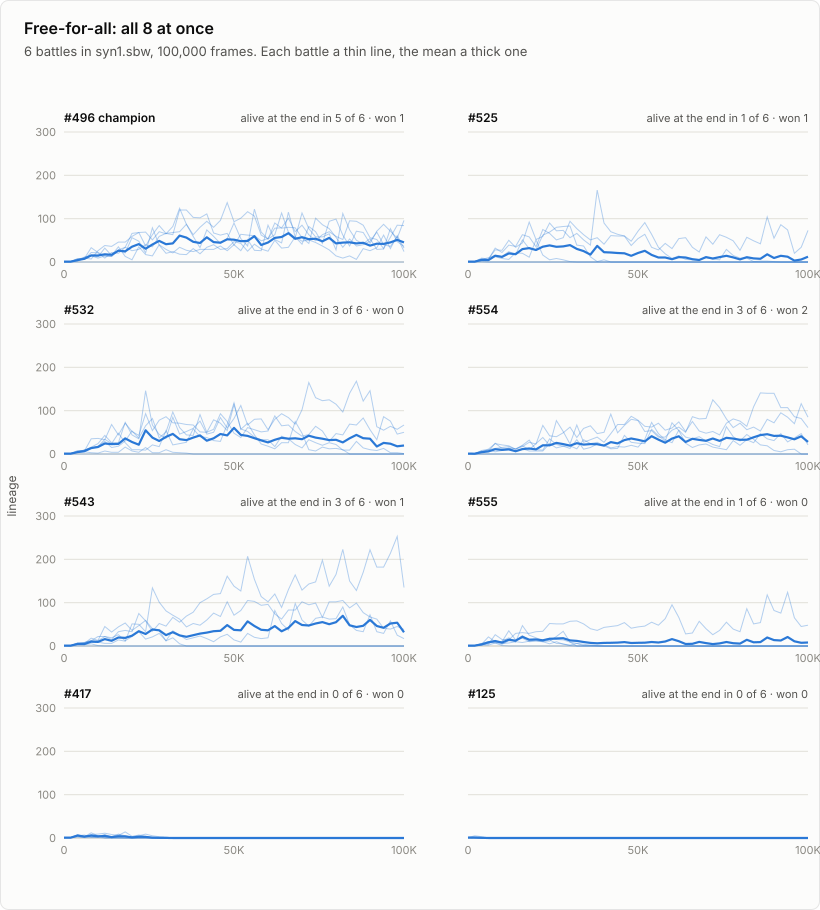
</picture>

## Toward a tournament mode

These battles are the core of a tournament mode planned for the game, as
an alternative build in this repository (its own `make` target and
binary), leaving the faithful 0.9 build as it is. Because a battle is
fully determined by its world, its seed and its contenders, the game can:

- set a tournament up paused: the world, the seed, the contenders and
  their order;
- run ahead headless, thousands of frames a second, to any frame;
- rebuild the window at any frame, by replaying to it or from a saved
  checkpoint (`.sbw` or `.bgw`), and step, rewind or fast-forward from
  there;
- present it all in an interface themed like SYN-OS and SYN-DEBT.

The results above are what such a mode would show for these contenders
on this world, and it can reproduce every one of them.

## Downloads

Every genetic code in the tournament is in [`beings/`](beings/), named by
its number (`beings/ID.bgg`), ready for the window's right-click
**Import** or the genetic laboratory. The champion is also
[`ultimate.bgg`](ultimate.bgg).

The contenders of the battles:

| Code | What | Symmetry | Genes | Disperses | Lineage per import, last round | Alive, last round | Head-to-head points of 42 | Alive after a free-for-all |
|---|---|---|---|---|---|---|---|---|
| [#496](beings/496.bgg) | the champion | 7 | 5 green, 2 blue, 1 yellow | no | 56.4 | 88% | 22 | 5 of 6 |
| [#525](beings/525.bgg) | bred, phase 2 generation 6 | 7 | 5 green, 2 blue, 1 yellow | yes | 51.2 | 92% | 27 | 1 of 6 |
| [#532](beings/532.bgg) | bred, phase 2 generation 6 | 7 | 5 green, 2 blue, 1 yellow | no | 47.8 | 71% | 27 | 3 of 6 |
| [#554](beings/554.bgg) | bred, phase 2 generation 8 | 7 | 5 green, 2 blue, 1 yellow | no | 47.5 | 83% | 28.5 | 3 of 6 |
| [#543](beings/543.bgg) | bred, phase 2 generation 7 | 7 | 5 green, 2 blue, 1 yellow | yes | 34.6 | 79% | 35.5 | 3 of 6 |
| [#555](beings/555.bgg) | bred, phase 2 generation 8 | 7 | 5 green, 2 blue, 1 yellow | yes | 12.4 | 54% | 11 | 1 of 6 |
| [#417](beings/417.bgg) | `syn1.sbw`'s third commonest species | 6 | 5 green, 2 blue, 1 yellow | no | 8.7 | 33% | 11 | 0 of 6 |
| [#125](beings/125.bgg) | the best natural champion | 1 | cyan, green, red, yellow | yes | 0 | 0% | 6 | 0 of 6 |

Other codes worth trying:
- [#382](beings/382.bgg) and [#403](beings/403.bgg), the eight-armed green
  stars, for a young world.
- [#415](beings/415.bgg), `syn1.sbw`'s commonest species.

The drawings of the finalists are in `beings/ID.svg`.

## Running it again

```sh
make being
tools/being/search.py natural             # the six long evolutions (minutes)
tools/being/search.py worlds              # the training and held-out worlds
tools/being/search.py run --world FILE    # the search; FILE is a saved world
tools/being/search.py growth              # the champion's lineage over time
tools/being/pictures.py                   # competitors.svg, beings/
tools/being/tournament.py                 # tournament.png (SYN-OS theme)
tools/being/battles.py                    # head-to-head and free-for-all battles
tools/being/pictures.py                   # (again, for the downloads)
tools/being/screenshot.py                 # the champion in the world, in-game
tools/being/charts.py                     # every chart on this page
```

Everything is deterministic: the same parameters and world give the same
tournament. The record of every candidate (its code, origin, parents, how
it was bred, and every run's result) is in
[`tournament.json`](tournament.json), and the search's own log in
[`log.txt`](log.txt).
