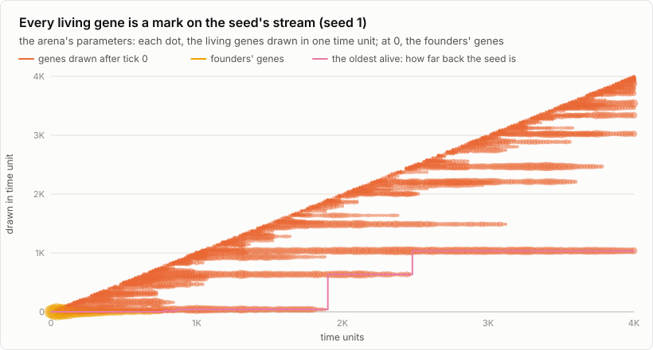
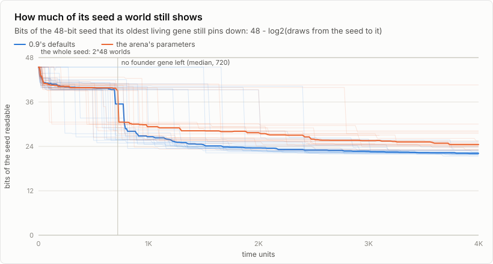
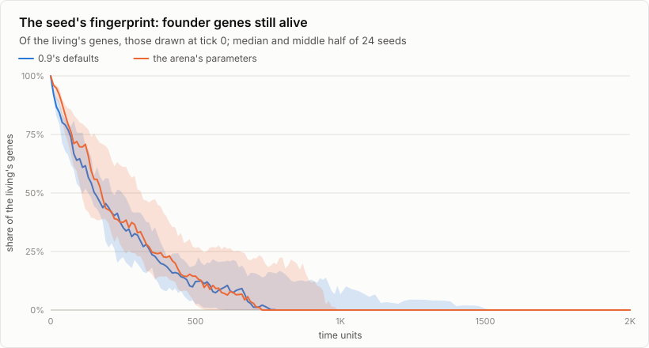
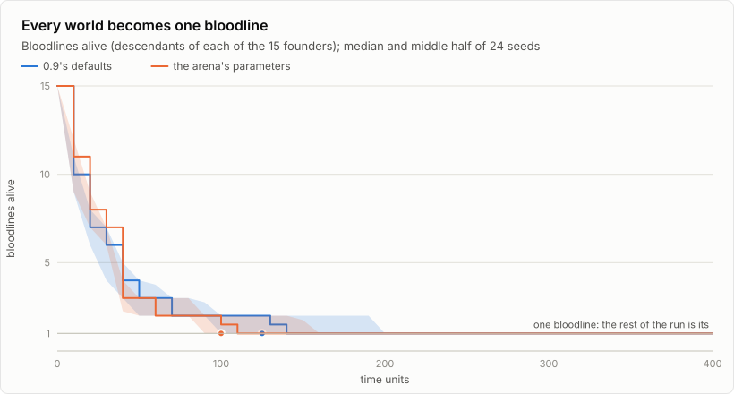
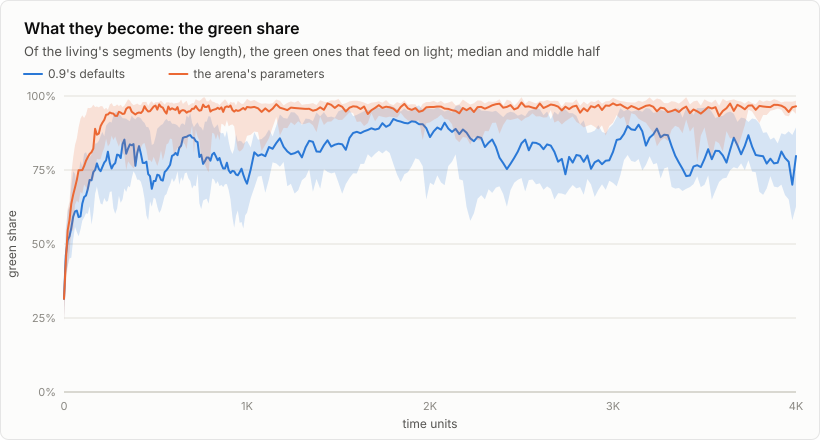
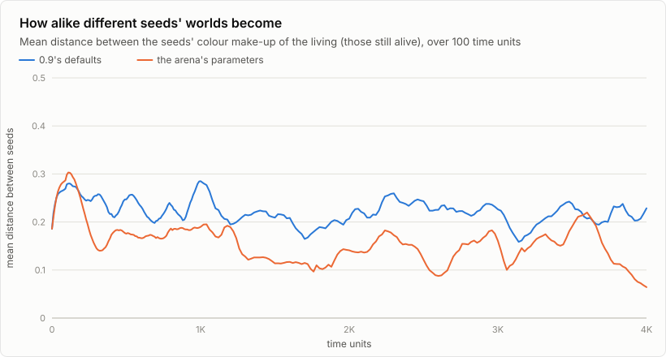

# The fade: what of its seed a world still shows

Two things kept turning up. The arena finds the lone bloodline that
survives a seed's genesis, and goes no further. The telescope reads the
seed of a young world but not of an old one. Both have exact descriptions,
measured here on 48 worlds: 24 seeds with 0.9's default parameters and 24
with the arena's (the user's saved ones, in [`params.cfg`](params.cfg)),
each 1,000 x 1,000 with 15 first organisms (the arena's small map), run
4,000 time units.

## One ring of dice

Every random decision in a world is a draw from one java.util.Random, the
step x → A·x + B (mod 2⁴⁸). Its period is all 2⁴⁸ states, so every state
lies on one ring. A seed is a starting point on the ring, and a world is an
arc of it that grows as the world runs.

Every gene length is one draw, so every gene is a point on its world's
arc. The telescope already gets a draw's state back from the length alone.
Now it also counts the draws between two states (`tel_draws`). That count
is the discrete logarithm of the step. It is easy here because the modulus
is a power of two: the low k bits of the states repeat every 2ᵏ draws, so
the count can be read a bit at a time from the bottom, in 48 steps. Given a
seed, then, every gene in a world has a place: the draw it was made at.

In this study every living gene in every sample was placed, and none was
left unread.

<picture>
  <source media="(prefers-color-scheme: dark)" srcset="marks-dark.svg">
  
</picture>

Each dot is the living genes drawn in one time unit. The diagonal is genes
just drawn. A horizontal streak is a gene that keeps being copied
unchanged. The founders' genes sit at 0 until about time 700. The pink step
is the oldest gene alive, the nearest any gene comes to the seed.

## How much of the seed a world still shows

To read the seed from a world, a search starts from the oldest gene alive
and steps back. Every starting point between the seed and that gene is a
seed it must try. So the seeds left to try number the draws from the seed
to the oldest gene, and 48 − log₂ of that count is how many bits of the
seed the world still pins down.

<picture>
  <source media="(prefers-color-scheme: dark)" srcset="bits-dark.svg">
  
</picture>

| Time unit | Founder genes alive (median) | Draws to the oldest gene | Bits readable | Draws made |
|---|---|---|---|---|
| 0 | 69 | 5 | 45.4 | 465 |
| 100 | 66 to 174 | 140 to 158 | 41 | 0.7 to 2.9 million |
| 500 | 15 to 40 | 274 to 292 | 40 | 2.3 to 10 million |
| 1,000 | 0 | 0.4 to 2.7 million | 27 to 29 | 5 to 22 million |
| 4,000 | 0 | 12 to 62 million | 22 to 25 | 16 to 88 million |

(Ranges: the arena's parameters, then 0.9's defaults.)

While founder genes live, the seed is a few hundred draws behind the oldest
gene, and the telescope finds it in seconds. The founder genes are gone by
a median of time unit 720 (the arena's parameters) or 740 (0.9's
defaults). After that the oldest gene was drawn millions of draws in, and
the seeds to try number in the millions, each to be replayed to that
gene's birth to be told apart.

<picture>
  <source media="(prefers-color-scheme: dark)" srcset="founders-dark.svg">
  
</picture>

That is the fade. The world never stops being a function of its seed, and
the seed is never lost. It moves out of the genes and into the fine detail:
positions, the last bits of each number, who touched whom. Only a replay
of every candidate reads it from there. `syn1.sbw`, at tick 1,494,509, is
far past this point (see the telescope in the main README).

## The lone bloodline

Every one of the 48 worlds came down to one bloodline, the descendants of a
single one of its 15 founders. The median time was unit 125 with 0.9's
defaults and 100 with the arena's parameters. Population genetics calls
this fixation by drift, or coalescence. In a population this small (25 to
67 alive), the lines of descent run back to one ancestor quickly, whatever
the codes are.

<picture>
  <source media="(prefers-color-scheme: dark)" srcset="lines-dark.svg">
  
</picture>

A round's winner is, first, the bloodline that got through this. The
arena's own record says the same of its rounds (ARENA > RECORD): of the 831
rounds whose start it has, one bloodline was left in 703 (85%), at a median
time of 72 (the middle half 46 to 114). The final being was its bloodline's
genesis being unchanged in 64 of 953 rounds, and 4 genes had changed in the
middle one.

## A final state?

With the arena's parameters (CO2 2,500), the worlds settle into one kind:
about 96% of the living's length is green, and the spread between seeds
falls from 0.3 to between 0.1 and 0.2. It keeps wandering, though: the
final state is a region the worlds move about in, not a point. With 0.9's
defaults they stay more varied (green around 80%, spread about 0.2).

<picture>
  <source media="(prefers-color-scheme: dark)" srcset="green-dark.svg">
  
</picture>

<picture>
  <source media="(prefers-color-scheme: dark)" srcset="converge-dark.svg">
  
</picture>

Five of the 24 worlds with the arena's parameters died out before time
4,000. Each is left out of the charts from then on.

## Where a being lives

The same maths runs backwards from a being (TELESCOPE > WHERE A BEING
LIVES, or WHERE IT LIVES in the library and the arena's record;
`syn-biogenesis --telescope find FILE.bgg` without a window). Its gene
lengths are cracked to the states that drew them, and then searched in
two places:

- **As founders.** Stepping back from a gene's state up to 4,096 draws, any
  seed whose founders have that gene is one it may come from. Seeds a few
  draws apart share most of the same stream, so the being's genes are in
  all of them. Each is replayed until one is the being's world. A near twin
  is given up a little after its stream has drawn the being's newest gene
  with nothing like the being alive.
- **In the arena's rounds.** Every round's seed is in the record, so each
  gene's place from each round's seed says which round drew it. A round
  makes a few million draws. A gene drawn elsewhere falls within 2³⁰ draws
  of a given round's seed about once in 2¹⁸.

Each find is a scene: a seed or round, a tick, and what is there (its gene
drawn, the being alive, the most of it, the round ending with it). JUMP
makes that world at that tick and opens it with the generator where it was
there, so it goes on as it went on. Checked on a test ladder: PAEBONE-5's
genes point to round 7 (three of them, drawn at ticks 868, 4,954 and
20,708; it is alive from tick 22,016) and round 3 (the fourth, at tick
120). The scene made for round 7 at tick 22,016 holds its exact code.

A being whose genes are all later draws, from a world whose seed is
nowhere on record, can't be placed. Its genes say where in a stream they
were drawn, not which stream: the fade again.

## Running it again

```sh
make
tools/fade/fade.py      # 2 x 24 worlds x 4,000 time units; about 25 minutes on 6 cores
tools/fade/charts.py
```

`fade.py` runs `syn-biogenesis --telescope fade SEED FRAMES EVERY` with
`docs/fade/params.cfg` as the saved parameters. It writes `samples.csv`
(every sample to time 1,000, then every other) and `marks.csv` (every
living gene's time unit of birth, for two seeds a set, every 20 time
units).
